# WICLOUD — Guide d'utilisation du tableau de bord

**Pour qui :** les clients (espace `/dashboard`) et l'équipe WICLOUD (back-office `/admin`).
**Version :** 18 octobre 2026 · plateforme analysée au commit `c71a9ae`
**Couverture :** les 9 onglets de l'espace client et les 15 onglets du back-office, leurs sous-pages et toutes leurs actions.

> **À propos des captures.** Elles sont prises dans l'application réelle, avec deux comptes de
> démonstration (`Client Démo` et `Admin Démo`) créés pour ce guide. Ces comptes n'ayant aucun
> historique, les écrans montrent les **états vides** — exactement ce que voit un nouveau compte.
> Cinq écrans du back-office (Vue d'ensemble, Utilisateurs, Messages du site, Équipe & accès,
> Journal d'activité) affichent de vraies données personnelles : sur ces captures, les noms et
> adresses des comptes réels sont **floutés**, et seuls les deux comptes de démonstration
> restent lisibles.

---

## 0. Avant de commencer

### 0.1 Où l'on arrive après connexion

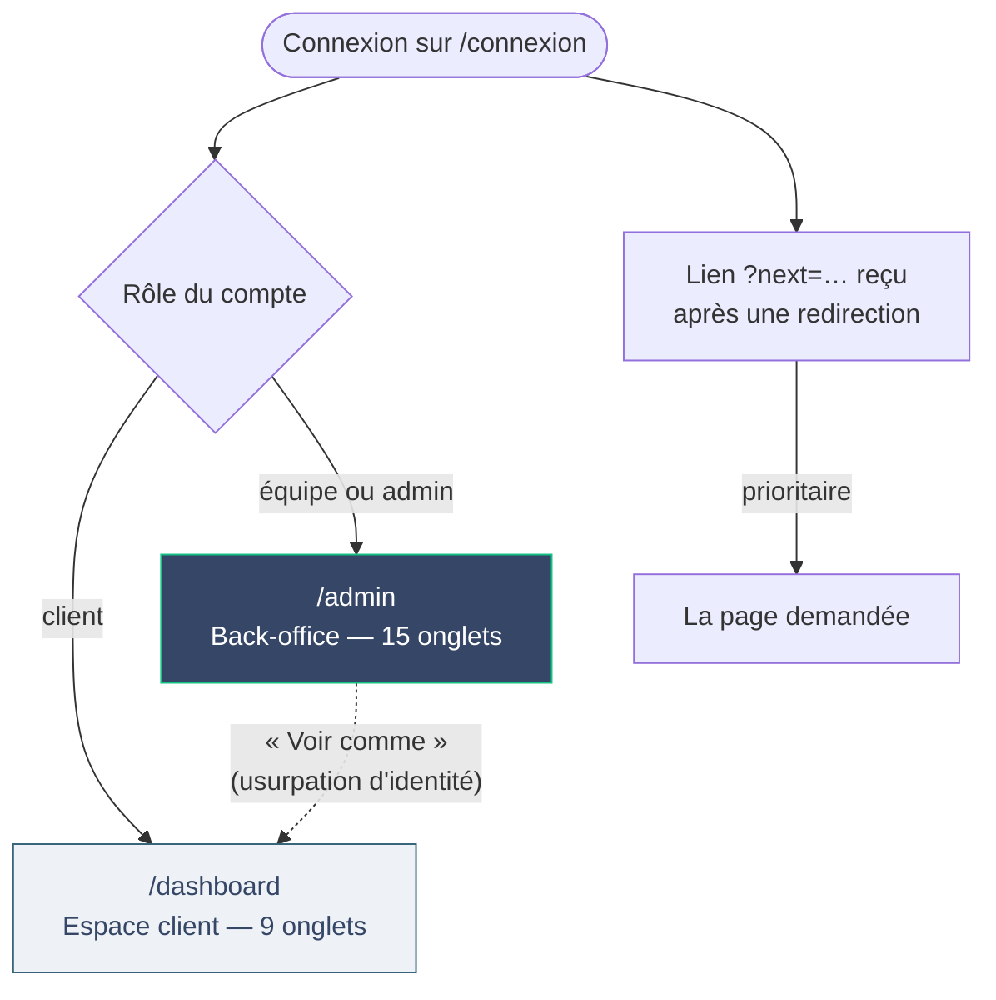

- Un compte **équipe** ou **admin** n'a qu'un seul tableau de bord : `/admin`. Il n'a pas d'espace client parallèle — pour voir ce que voit un client, on utilise l'usurpation d'identité depuis sa fiche.
- La connexion par **lien magique** et par **Google** ramène toujours vers l'espace client ; un membre de l'équipe rejoint ensuite `/admin` par l'URL ou le menu.

### 0.2 Les éléments communs à toutes les pages

| Élément | Où | Ce qu'il fait |
| --- | --- | --- |
| **Barre latérale** | à gauche | La liste des onglets. Repliable ; sur mobile elle s'ouvre en tiroir. Côté `/admin`, **un onglet n'apparaît que si votre compte a la permission correspondante**. |
| **Cloche de notifications** | en haut | Le compteur de non-lues. Il se met à jour **en direct**, sans rafraîchir la page. Un clic mène à votre propre fil de notifications. |
| **Rafraîchissement temps réel** | invisible | Dès qu'une donnée vous concernant change (réponse, devis, facture, démo), la page ouverte se met à jour seule et un bandeau apparaît. |
| **Bandeau d'usurpation** | en haut, en cours de session | Visible uniquement quand un administrateur navigue « comme » un client. Un bouton permet de revenir à son propre compte. |

### 0.3 Si vous n'avez pas accès à une page

- **« Accès refusé »** : votre compte n'a pas la permission demandée — la page vous dit laquelle. Un administrateur peut vous l'accorder depuis votre fiche.
- **« Page introuvable » (404)** sur un dossier qui devrait exister : il ne vous appartient pas. C'est volontaire — la plateforme ne confirme jamais l'existence d'un dossier qui n'est pas le vôtre.
- **« Compte suspendu »** : le compte est désactivé ; contactez l'administrateur.

---

# Partie A — L'espace client (`/dashboard`)

9 onglets. Aucun ne demande de permission particulière : il suffit d'être connecté, et vous ne voyez que vos propres données.

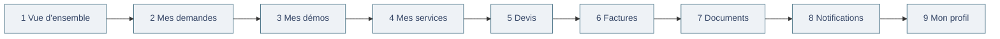

## A1 — Vue d'ensemble

`/dashboard` · *la page d'accueil de votre espace.*

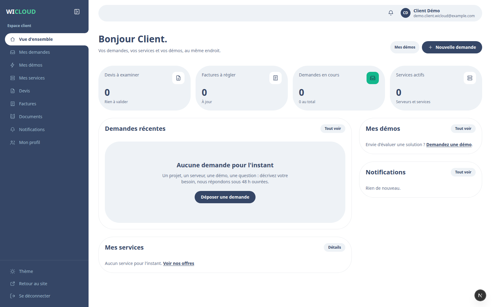

**Ce que vous y voyez**

- Un bloc **« À faire »** : ce qui attend une action de votre part — `Devis à examiner`, `Factures à régler`, `Demandes en cours`, `Services actifs`.
- **Demandes récentes**, les plus récentes d'abord, avec un lien `Tout voir`.
- **Mes services** : les services actuellement en fonctionnement, avec un lien `Détails`.
- **Mes démos** : les accès de démonstration qui vous ont été ouverts.
- Si vous n'avez encore rien déposé, la page propose directement `Déposer une demande`.

**Ce que vous pouvez faire** : `Nouvelle demande`, ouvrir n'importe quel élément listé, `Voir nos offres`, `Demandez une démo`.

> Le délai annoncé sur cette page est de **48 h ouvrées** pour une première réponse.

## A2 — Mes demandes

`/dashboard/demandes` · *tous vos dossiers, ouverts et clos.*

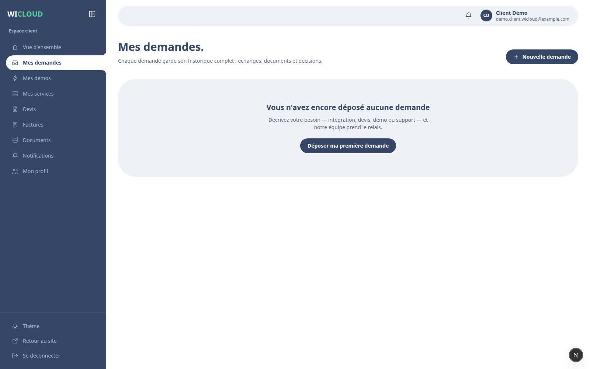

**La liste** — chaque demande affiche sa **référence** (`WC-AAMM-NNNN`), son titre, son type, son statut et sa dernière activité.

Les cinq statuts possibles :

| Statut | Ce qu'il signifie |
| --- | --- |
| `Nouvelle` | Déposée, pas encore prise en charge. |
| `En cours` | L'équipe travaille dessus. |
| `Acceptée` | Le principe est validé ; la réalisation suit. |
| `Refusée` | Dossier clos sans suite. |
| `Terminée` | Dossier clos, livré. |

### A2.1 — Déposer une demande

`/dashboard/demandes/nouvelle`

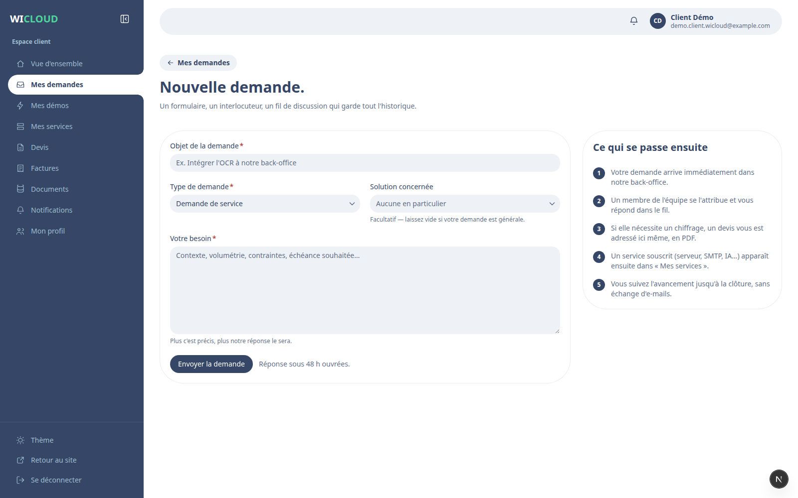

Le formulaire demande : un **type** (demande de service, de démo, de devis, ou support), la **solution concernée** (facultatif), un **titre**, le **détail** de votre besoin, une **priorité** et un **budget** indicatif (facultatif).

Un encadré **« Ce qui se passe ensuite »** décrit la suite : un interlocuteur, un fil de discussion unique qui conserve tout l'historique.

### A2.2 — Le détail d'une demande

`/dashboard/demandes/<id>`

- **Échanges** : le fil de discussion avec l'équipe. Les messages sont groupés par jour, un séparateur marque les non-lus, et la mention **« Lu »** apparaît quand l'autre partie a ouvert le fil.
- **Pièces jointes** : vous pouvez joindre un fichier à n'importe quel message.
- **Informations** : référence, type, solution, priorité, dernière activité, date de clôture.
- **Devis liés** : les chiffrages produits à partir de cette demande.
- Vous pouvez **clôturer vous-même** une demande qui n'a plus lieu d'être.

> Les notes internes de l'équipe ne vous sont **jamais** affichées.

## A3 — Mes démos

`/dashboard/demos` · *les accès d'évaluation préparés pour vous.*

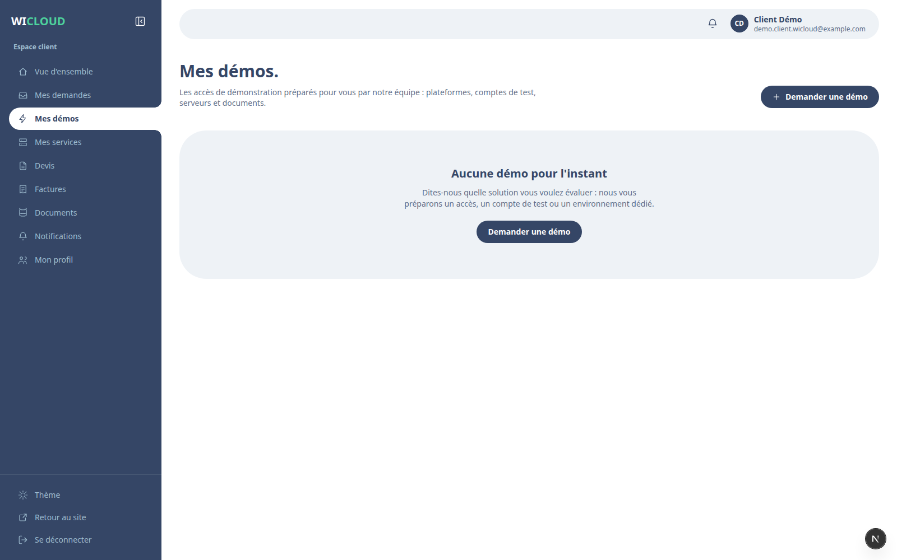

Une démo n'est pas un bac à sable générique : c'est un accès que l'équipe **vous a attribué nominativement**. Si aucun ne vous a été ouvert, la page vous invite à en demander un.

### A3.1 — Le détail d'une démo

`/dashboard/demos/<slug>`

Une démo est composée de **blocs**, dans l'ordre choisi par l'équipe. Les sept types possibles :

| Bloc | Ce que vous en faites |
| --- | --- |
| **Lien** | Ouvre la plateforme à évaluer. Certains s'affichent directement dans la page. |
| **Identifiants** | Un compte de test. Le mot de passe reste masqué : un bouton **« Afficher »** le révèle à la demande. |
| **Texte / guide** | Des instructions rédigées. |
| **Page HTML** | Un contenu présenté dans un cadre isolé. |
| **Fichier** | Un document à télécharger (guide, schéma, PDF). |
| **Accès SSH** | Hôte, port, utilisateur — et le secret, révélé de la même façon. |
| **Dépôt de fichier** | Vous envoyez un fichier, l'équipe le traite et vous répond avec un livrable. |

**À savoir sur les secrets** : chaque affichage est **tracé**. Un accès peut avoir une **date d'expiration** ; passé ce délai, le secret n'est plus révélé.

**Le cycle d'un dépôt de fichier** :

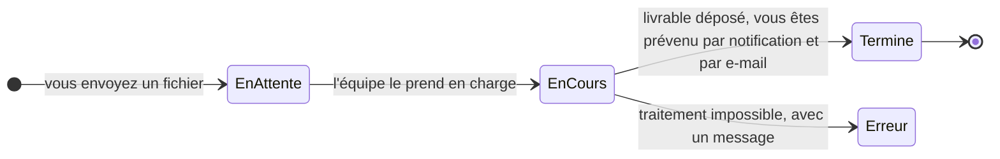

## A4 — Mes services

`/dashboard/abonnement` · *vos serveurs, votre infrastructure, vos services à la consommation.*

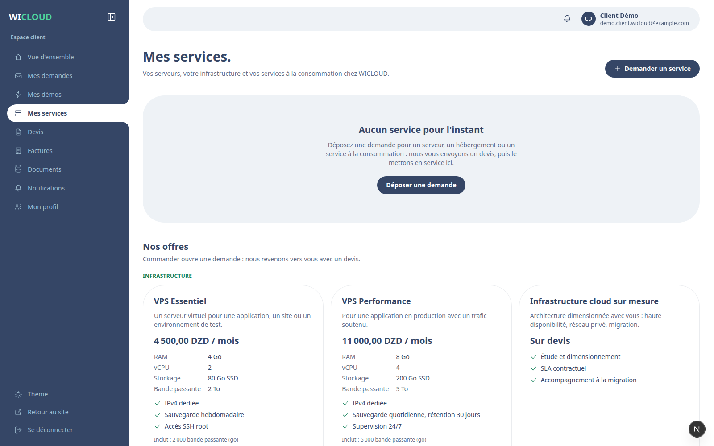

- **La liste des services actifs**, chacun avec son libellé, sa date de souscription, son prix, sa période de facturation, sa fiche technique et ses **informations d'accès** (URL de panneau, IP, nom d'hôte).
- **Consommation** : vos quotas, avec une barre par métrique — envois SMTP, requêtes IA, SMS, stockage, bande passante.
  - *Aucune limite affichée* = non mesuré.
  - *Limite à 0* = non inclus dans votre service (ce n'est pas la même chose qu'un quota épuisé).
  - Les compteurs mensuels se remettent à zéro au début de chaque mois ; le stockage est un total permanent.
- **Services résiliés** : l'historique, conservé.
- Boutons : `Demander un service`, `Demander de l'aide`, `Nos offres`.

> Un service n'apparaît ici qu'une fois **mis en service par l'équipe** — généralement après un devis accepté.

## A5 — Devis

`/dashboard/devis` · *les propositions chiffrées qui vous ont été adressées.*

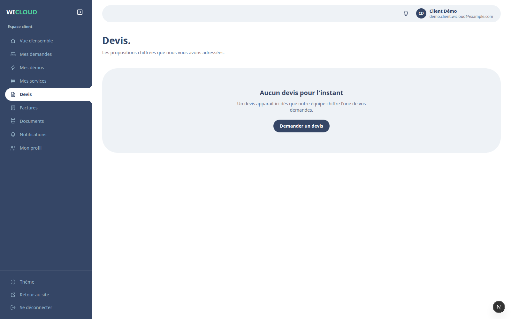

La liste affiche la référence (`DV-AAMM-NNNN`), le titre, le montant et le statut : `Brouillon` *(jamais visible pour vous)*, `En attente de réponse`, `Accepté`, `Refusé`, `Expiré`.

### A5.1 — Le détail d'un devis

`/dashboard/devis/<id>`

- **Détail** : les lignes chiffrées, le montant HT, la TVA le cas échéant, le total.
- **Document** : `Voir le PDF` et `Télécharger` — exactement le document qui vous a été envoyé.
- **Votre réponse** : **accepter** ou **refuser**. L'équipe est prévenue immédiatement.
- **Demande liée** : le dossier d'origine.

> Un devis **expire** automatiquement à sa date de validité s'il n'a pas reçu de réponse.

## A6 — Factures

`/dashboard/factures` · *le détail de chaque facture et son état de règlement.*

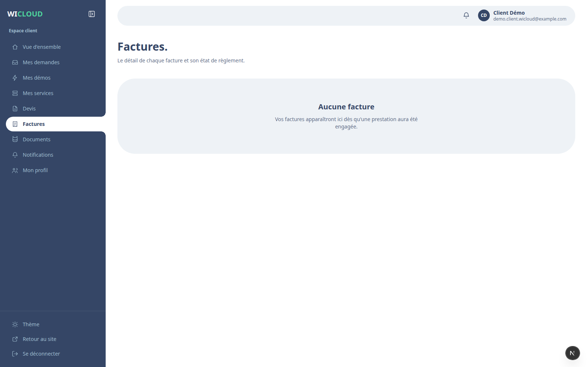

En haut : `Reste à régler` et `Déjà réglé`. Chaque facture affiche sa référence (`FA-AAMM-NNNN`), son montant, son échéance et son statut : `Brouillon`, `À régler`, `Payée`, `En retard`, `Annulée`. Le PDF est consultable et téléchargeable.

> Une facture dont l'échéance est dépassée bascule d'elle-même en **« En retard »**. Le passage à **« Payée »** est fait à la main par l'équipe après constat du règlement — il n'y a pas de paiement en ligne.

## A7 — Documents

`/dashboard/documents` · *tous les fichiers échangés, quel que soit le dossier.*

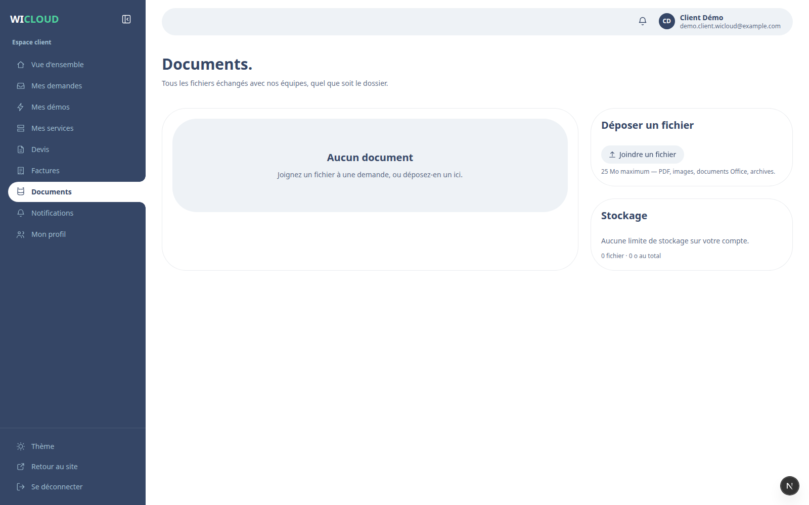

- La liste complète : nom, type, taille, date, et le dossier d'origine.
- **Déposer un fichier** directement ici, sans passer par une demande.
- **Stockage** : votre consommation par rapport à l'allocation.

**Limites** : 25 Mo par fichier. Types acceptés : PDF, PNG, JPEG, WebP, GIF, texte, CSV, Markdown, HTML, ZIP, Word, Excel, PowerPoint.

> Les liens de téléchargement sont générés à la demande et **expirent** — un lien copié ne reste pas valable.

## A8 — Notifications

`/dashboard/notifications` · *votre fil complet.*

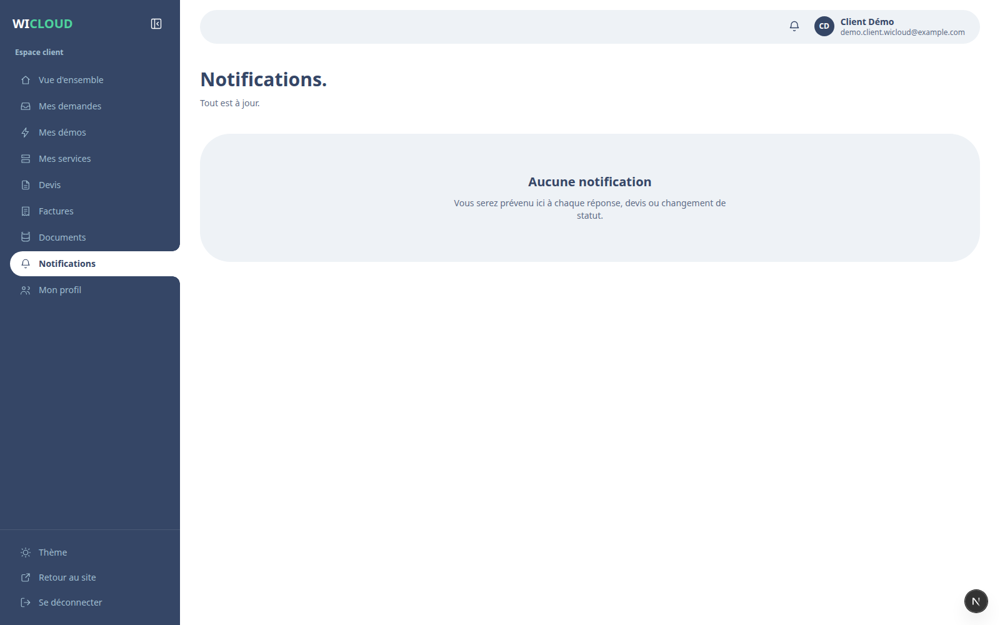

Chaque notification porte un titre, un extrait, une date et un lien direct vers l'élément concerné. Actions : **tout marquer comme lu**, **marquer une notification**, **en supprimer une**, **effacer celles déjà lues**. Ouvrir une notification la marque lue et vous emmène au bon endroit.

## A9 — Mon profil

`/dashboard/profil`

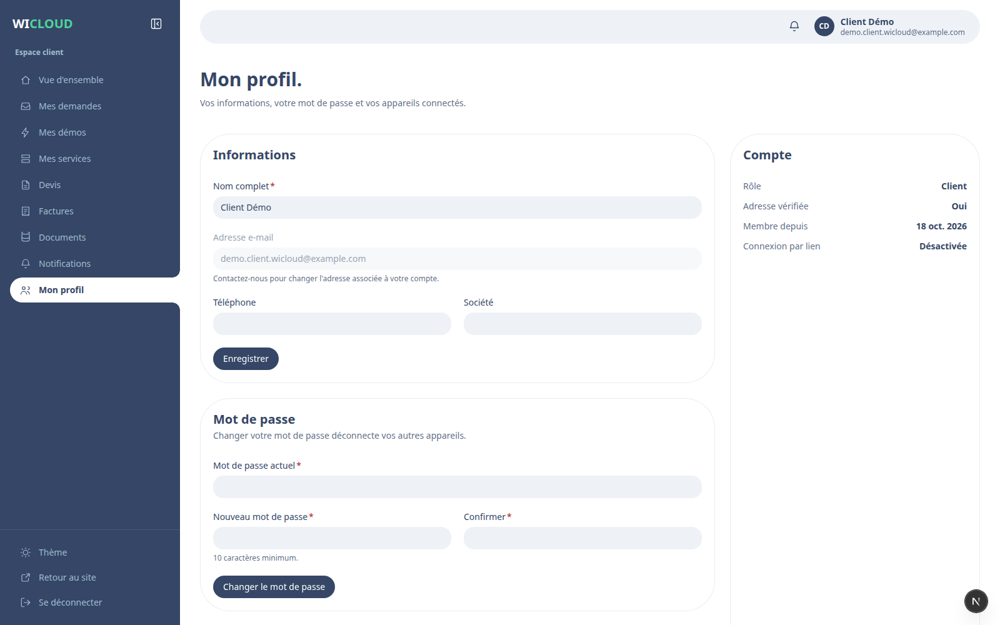

- **Informations** : nom, téléphone, société. L'adresse e-mail est affichée avec son état de vérification, ainsi que votre rôle et votre date d'inscription.
- **Mot de passe** : le changer **déconnecte tous vos autres appareils**. Les règles (longueur, variété de caractères) sont vérifiées à la saisie.
- **Appareils connectés** : la liste de vos sessions.
- **Connexion par lien** : indique si la connexion par lien magique est ouverte pour votre compte.

---

# Partie B — Le back-office (`/admin`)

15 onglets. **Chaque onglet exige une permission** — sauf *Vue d'ensemble*, *Notifications* et *Mon profil*, qui appartiennent à tout compte du back-office. Un onglet dont vous n'avez pas la permission **n'apparaît pas** dans la barre latérale.

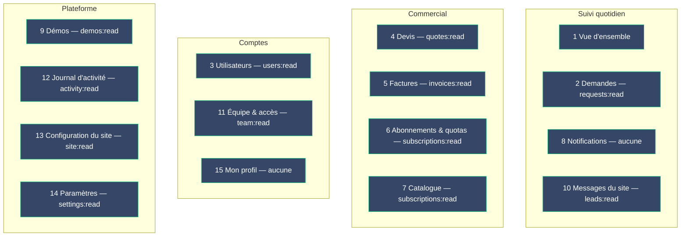

## B1 — Vue d'ensemble

`/admin` · *ce qui attend une action, et l'état général de la plateforme.* **Aucune permission requise.**

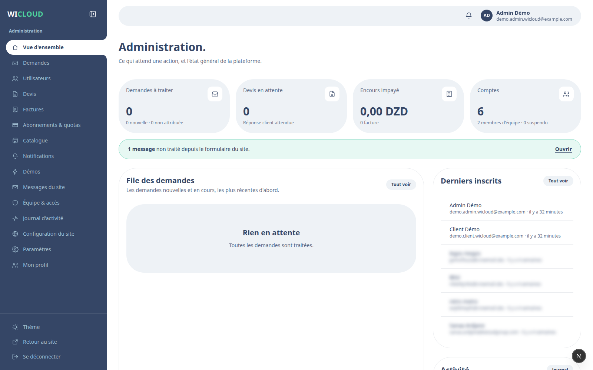

> 📷 Les noms et adresses des comptes réels sont **floutés** sur cette capture ; les deux comptes de démonstration restent lisibles.

- Quatre indicateurs : `Demandes à traiter`, `Devis en attente`, `Encours impayé`, `Comptes`.
- **File des demandes** : les nouvelles et celles en cours, les plus récentes d'abord. « Rien en attente » quand la file est vide.
- **Derniers inscrits**.
- **Activité** : les dernières actions du back-office, avec un lien vers le journal complet.

## B2 — Demandes

`/admin/demandes` · permission **`requests:read`** *(agir demande `requests:write`)*

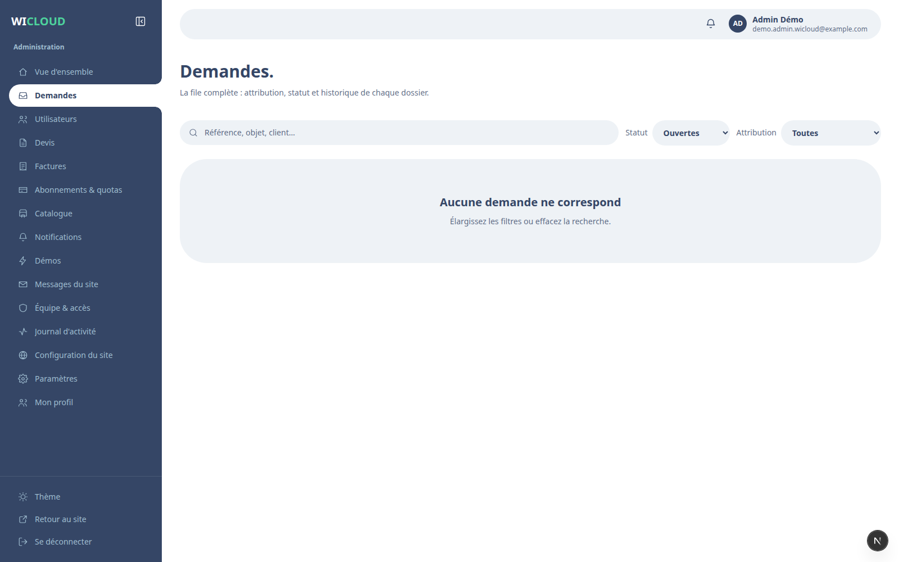

**La file complète.** Filtres par statut, par type, par personne assignée, plus une recherche. Par défaut, les dossiers clos sont écartés. Une demande non attribuée est signalée `Non attribuée`.

### B2.1 — Le détail d'une demande

`/admin/demandes/<id>`

| Zone | Ce qu'on y fait |
| --- | --- |
| **Fil de discussion** | Répondre au client. Une réponse peut être marquée **note interne** — elle reste invisible côté client. `Joindre un livrable` attache un fichier. |
| **Statut** | Faire avancer le dossier. **Seules les transitions valides sont proposées** : depuis `Nouvelle` → en cours / acceptée / refusée ; depuis `En cours` → acceptée / refusée / terminée ; depuis `Acceptée` → en cours / terminée. `Refusée` et `Terminée` sont définitives. |
| **Attribution** | Assigner le dossier à un membre de l'équipe — qui en est notifié. |
| **Détails** | Modifier le type, la solution, la priorité, le budget. |
| **Client** | Un résumé, et `Voir la fiche complète`. |
| **Raccourcis** | `Établir un devis` et `Provisionner un service` — les deux partent pré-remplis depuis la demande. |
| **Suppression** | Possible avec `requests:delete`. Irréversible. |

## B3 — Utilisateurs

`/admin/utilisateurs` · permission **`users:read`**

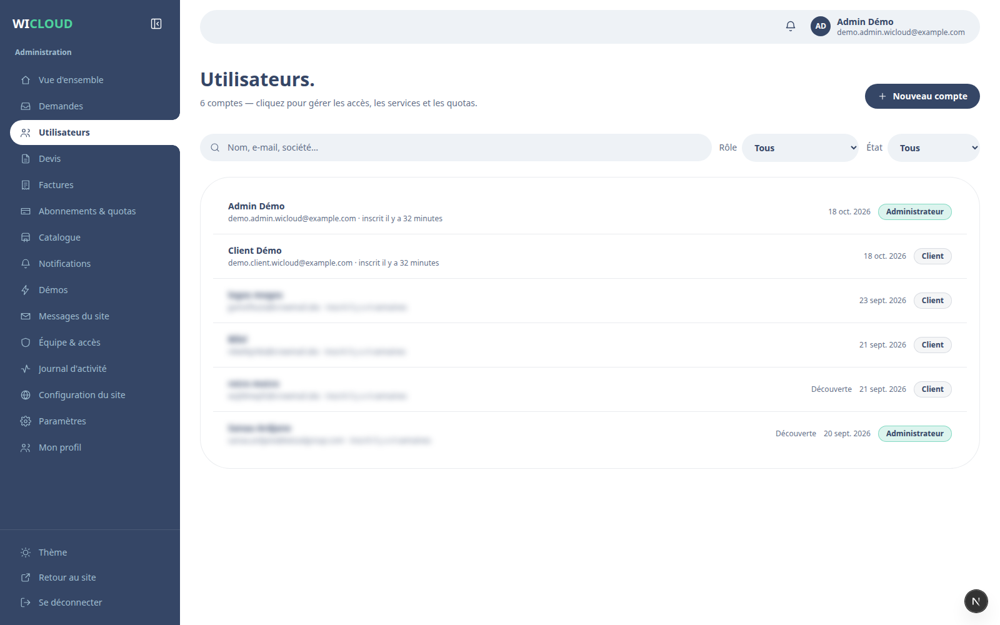

> 📷 Les quatre comptes réels sont **floutés** ; les deux comptes de démonstration restent lisibles.

La liste de tous les comptes, avec recherche et filtres (rôle, état). Les comptes suspendus sont marqués `Suspendu`.

### B3.1 — Créer un compte

`/admin/utilisateurs/nouveau` · **`users:write`** — et **`team:write`** en plus pour créer autre chose qu'un compte client.

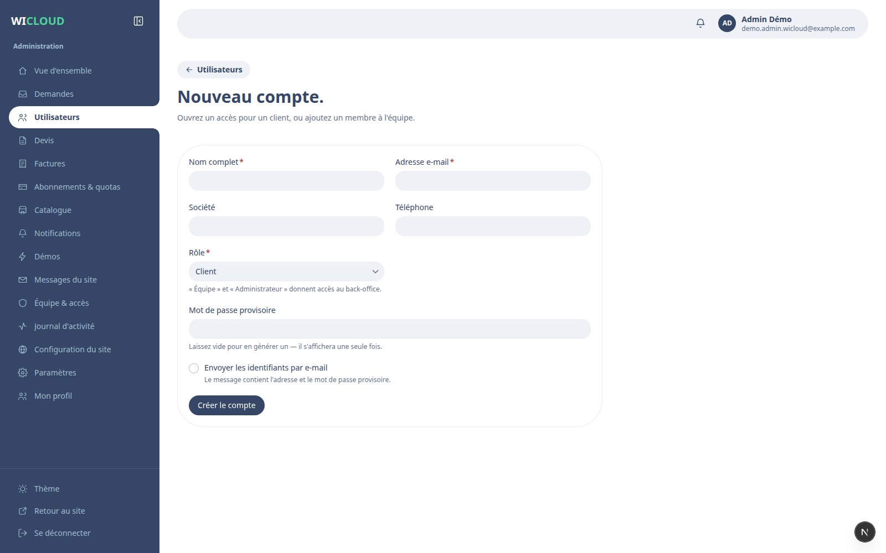

Nom, e-mail, téléphone, société, rôle. **Le mot de passe est facultatif** : laissé vide, la plateforme en génère un conforme et l'affiche **une seule fois** dans le bandeau de confirmation. C'est fait pour le cas « un client au téléphone, il lui faut un accès tout de suite » — notez-le avant de quitter la page.

### B3.2 — La fiche d'un compte

`/admin/utilisateurs/<id>`

- **Fiche** : coordonnées, rôle, adresse vérifiée, dernière activité, note interne réservée à l'équipe.
- **Accès** : le rôle donne une base, puis **une grille de cases à cocher** ajoute ou retire chaque permission individuellement (13 domaines × 3 actions). Modifier un rôle ou une permission exige **`team:write`**.
- **Services** : ce que ce client a souscrit, avec un bouton `Provisionner`.
- **Quotas** : poser ou retirer une limite à la main, métrique par métrique.
- **Demandes récentes**.
- **Actions** : envoyer un message, **suspendre** / rétablir, **« voir comme »** (usurpation d'identité — vous voyez exactement l'espace client de cette personne, avec un bandeau permanent), **supprimer** le compte.

> Trois règles que la plateforme fait respecter, quelles que soient vos permissions : **on n'agit pas sur son propre compte**, le **dernier administrateur actif** ne peut être ni rétrogradé, ni suspendu, ni supprimé, et seul **`team:write`** touche aux rôles et aux permissions.

## B4 — Devis

`/admin/devis` · permission **`quotes:read`** *(agir : `quotes:write`)*

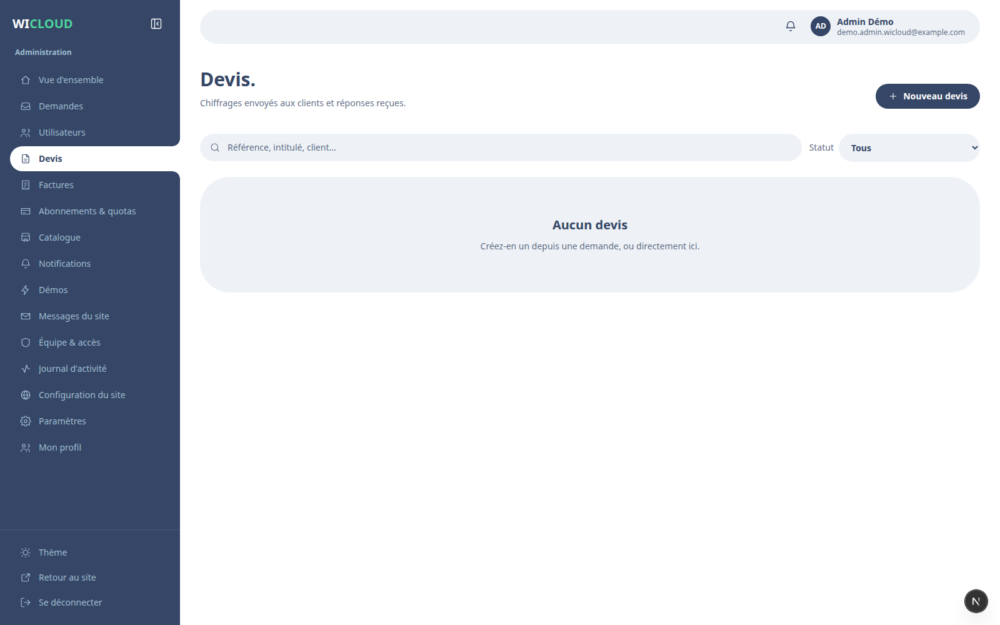

La liste des chiffrages et des réponses reçues. `Nouveau devis` en crée un — mais le plus souvent on part d'une demande.

### B4.1 — Rédiger et envoyer un devis

`/admin/devis/nouveau`, puis `/admin/devis/<id>`

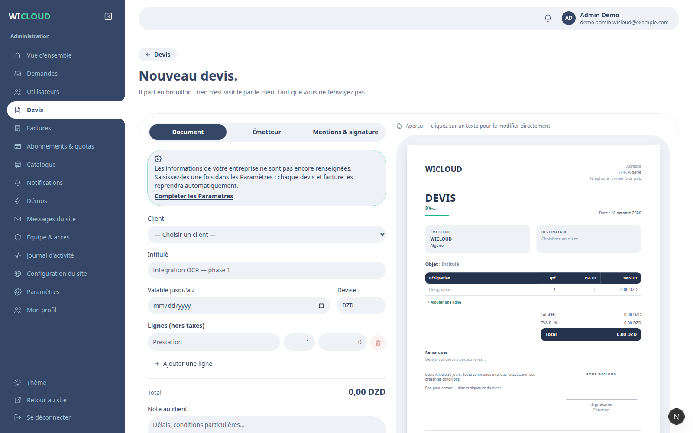

L'éditeur est en deux parties : **le formulaire à gauche, l'aperçu du document à droite**, tous deux synchronisés. On peut aussi écrire directement dans l'aperçu.

- **Contenu du devis** : titre, lignes (libellé, quantité, prix unitaire), montant calculé, devise, date de validité, note.
- **Identité de l'émetteur** : chaque champ imprimé (mentions légales, coordonnées bancaires, TVA, logo, signature, conditions) peut être **réécrit pour ce devis uniquement**. Sans modification, ce sont les valeurs des *Paramètres*.
- **Document et envoi** : `Aperçu PDF exact` affiche le document réel, puis l'envoi l'expédie au client. **Les octets envoyés sont archivés** : des mois plus tard, on peut rouvrir exactement ce qui a été envoyé. Un devis peut être renvoyé.
- **Créer la facture** : reprend les lignes *et* l'identité de l'émetteur du devis.
- **Suivi** : montant, validité, date d'envoi, dernière modification.

> Un devis qui a **reçu une réponse ne se modifie plus** — la page le dit explicitement.

## B5 — Factures

`/admin/factures` · permission **`invoices:read`** *(agir : `invoices:write`)*

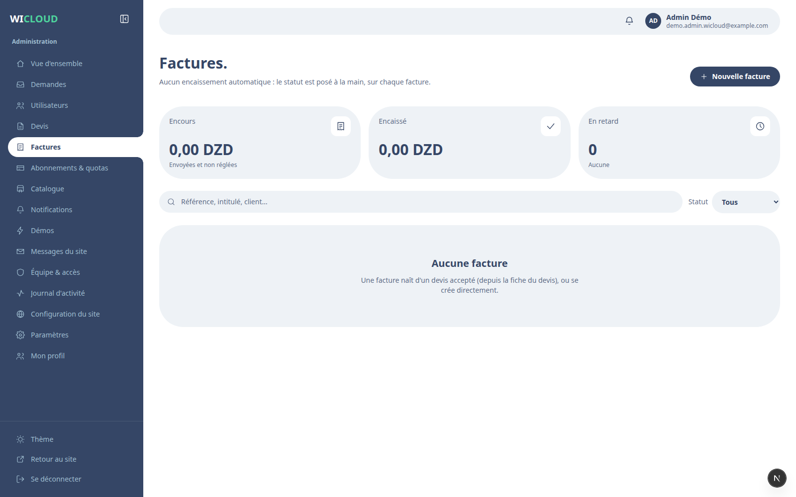

En haut : `Encours`, `Encaissé`, `En retard`.

### B5.1 — Le détail d'une facture

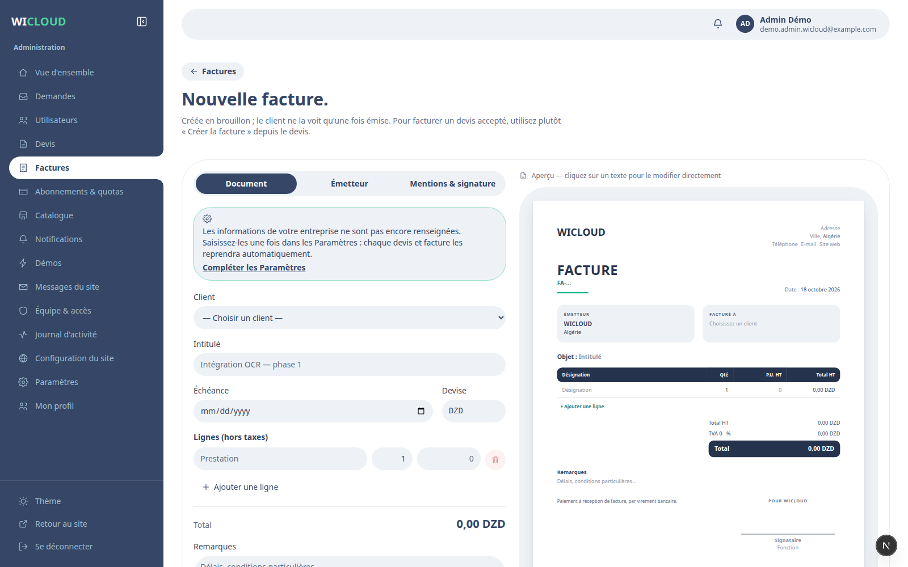

`/admin/factures/<id>` — même éditeur que les devis (formulaire + aperçu vivant, identité de l'émetteur réécrivable par document).

- **Statut et règlement** : `Brouillon` → `À régler` → `Payée`, ou `Annulée`. **Il n'y a aucun encaissement automatique : le statut est posé à la main.** Une facture dont l'échéance est passée s'affiche d'elle-même `En retard`.
- **Document et envoi** : même mécanisme d'archivage que les devis.
- **Suivi** : montant HT, date d'émission, échéance, date de règlement.

> Une facture **payée ou annulée ne se modifie plus**. Pour facturer un devis accepté, passez par `Créer la facture` depuis le devis plutôt que par `Nouvelle facture`.

## B6 — Abonnements & quotas

`/admin/abonnements` · permission **`subscriptions:read`** *(agir : `subscriptions:write`)*

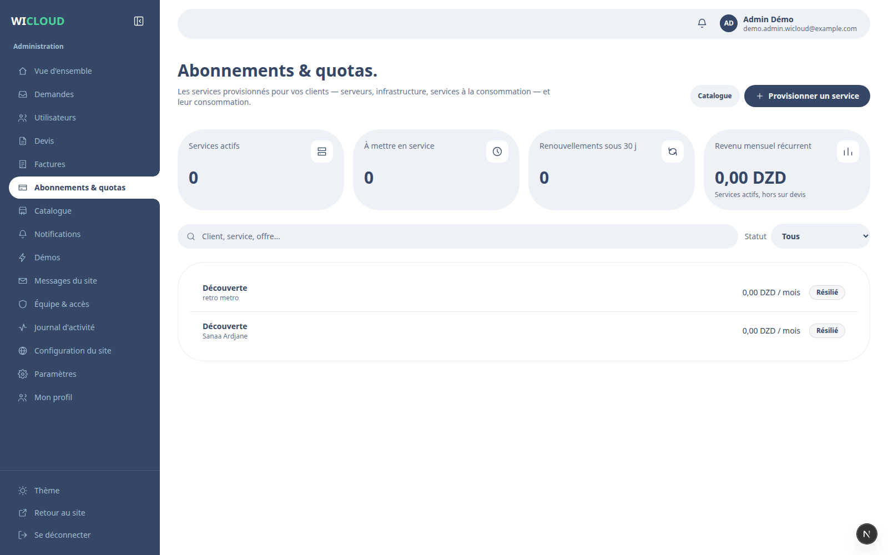

Quatre indicateurs : `Services actifs`, `À mettre en service`, `Renouvellements sous 30 j`, `Revenu mensuel récurrent`. Un bloc **« Proches de la limite »** signale les clients dont un quota arrive à saturation.

### B6.1 — Provisionner un service

`/admin/abonnements/nouveau` — idéalement lancé depuis une demande ou un devis accepté, ce qui pré-remplit le lien.

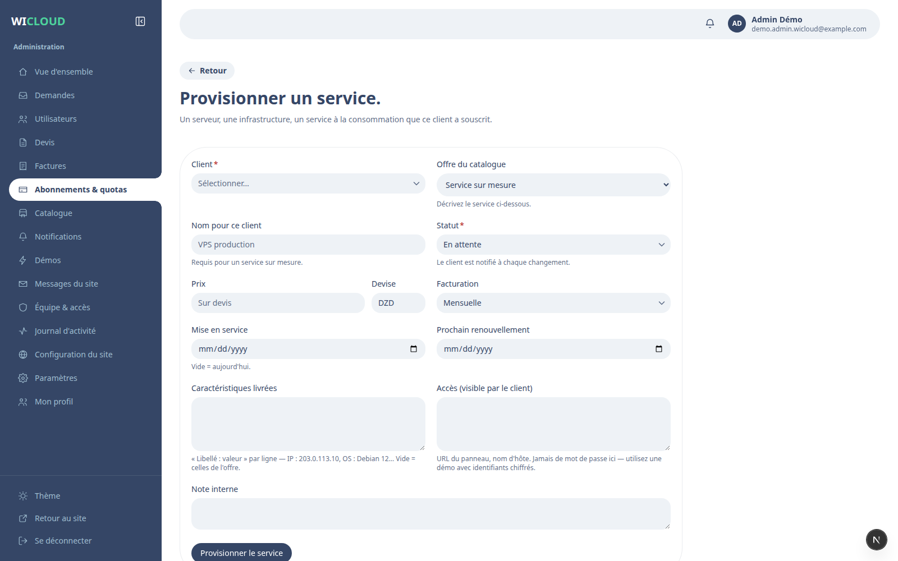

Client, offre du catalogue *(ou service sur mesure, sans offre)*, libellé, prix, période de facturation, fiche technique livrée, informations d'accès, date de renouvellement.

> **Le prix et la fiche technique sont recopiés** au moment de la mise en service. Modifier le catalogue plus tard ne change **jamais** un service déjà livré.

### B6.2 — La fiche d'un service

`/admin/abonnements/<id>` — cycle de vie :

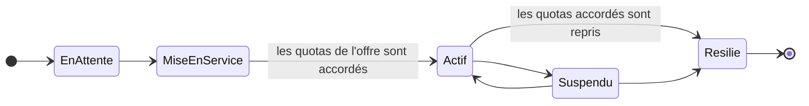

On y trouve aussi la **consommation du client** et une **zone sensible** (suppression).

> **Le client est notifié à chaque changement d'état.** Les quotas d'une nouvelle offre **s'ajoutent** aux allocations existantes — souscrire un second service SMTP ne remplace pas le premier.

## B7 — Catalogue

`/admin/catalogue` · permission **`subscriptions:read`** *(agir : `subscriptions:write`)*

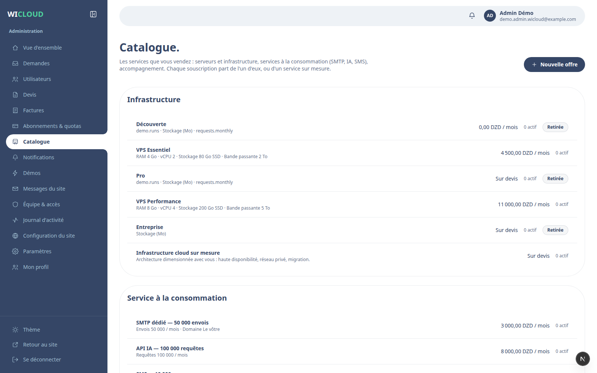

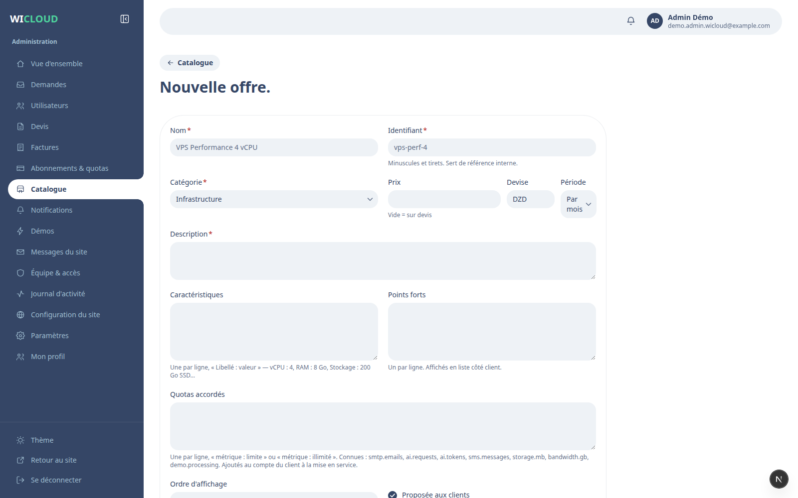

Ce que WICLOUD vend : serveurs, cloud sur mesure, SMTP, API IA, SMS, stockage, hébergement infogéré.

Chaque offre (`/admin/catalogue/<slug>`) porte : nom, description, catégorie, prix et période *(prix vide = « sur devis »)*, fiche technique libre, liste d'arguments, **quotas accordés** à la mise en service, ordre d'affichage, et un état actif/retiré. La fiche liste aussi les **souscriptions** en cours sur cette offre, et comporte une zone sensible.

## B8 — Notifications

`/admin/notifications` · **aucune permission** — c'est *votre* fil, celui que compte la cloche.

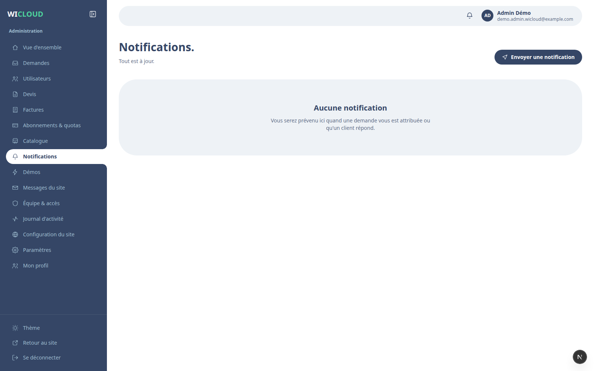

Mêmes actions que côté client. Si vous avez **`notifications:write`**, un bouton `Envoyer une notification` mène au composeur.

### B8.1 — Envoyer une notification

`/admin/notifications/envoyer` · **`notifications:write`**

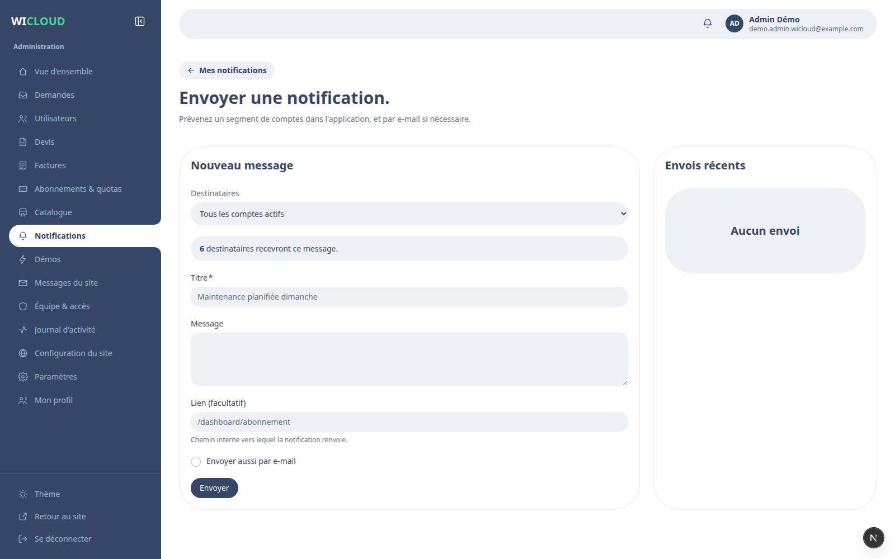

Choisissez un **segment** de destinataires, un titre, un message, un lien facultatif, et cochez le cas échéant **l'envoi par e-mail en plus** de la notification dans l'application. La page liste les **envois récents**.

## B9 — Démos

`/admin/demos` · permission **`demos:read`** *(agir : `demos:write`)*

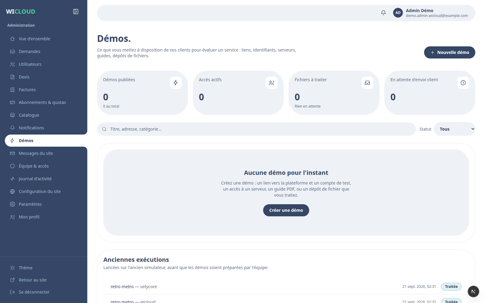

Indicateurs : `Démos publiées`, `Accès actifs`, `Fichiers à traiter`, `En attente d'envoi client`. Deux files : **File de traitement** (les dépôts clients à traiter) et **Anciennes exécutions**.

### B9.1 — Créer une démo

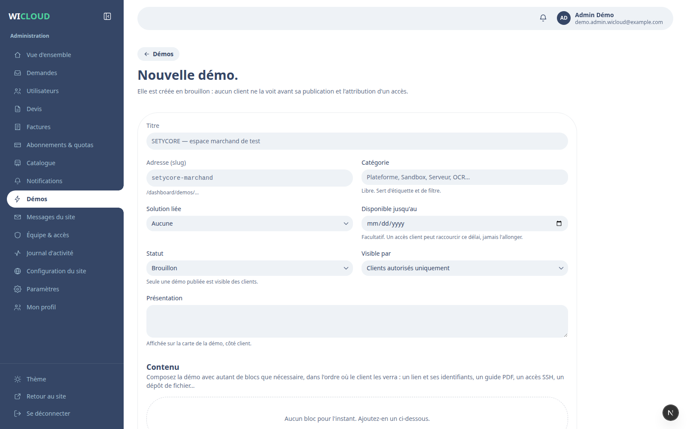

`/admin/demos/nouveau` — elle naît **en brouillon** : personne ne la voit avant publication *et* attribution d'un accès.

### B9.2 — L'éditeur d'une démo

`/admin/demos/<id>`

- **Contenu** : on empile les blocs (lien, identifiants, texte, HTML, fichier, SSH, dépôt de fichier), on les réordonne, on les supprime. Les **secrets** (mots de passe, clés SSH) sont **chiffrés** : une fois enregistrés, ils ne se relisent que via le bouton d'affichage, et chaque affichage est tracé.
- **Publication** : brouillon → publiée → archivée. Visibilité : *comptes autorisés uniquement* ou *tous les clients connectés*. Une **date d'expiration** peut couvrir toute la démo.
- **Accès** : accorder l'accès à un client nommé, avec une note interne et une expiration propre *(qui ne peut que raccourcir celle de la démo)*. `Révoquer` conserve la trace de l'attribution.
- **Exécutions** : pour chaque dépôt client — `Envoyé par le client` et `Livré`. On répond avec une note et `Joindre le résultat` ; le client est **notifié et prévenu par e-mail**.

> Si la clé de chiffrement n'est pas configurée, la plateforme **refuse** de livrer un secret plutôt que de l'enregistrer en clair. L'état est visible dans *Paramètres*.

## B10 — Messages du site

`/admin/messages` · permission **`leads:read`** *(agir : `leads:write`)*

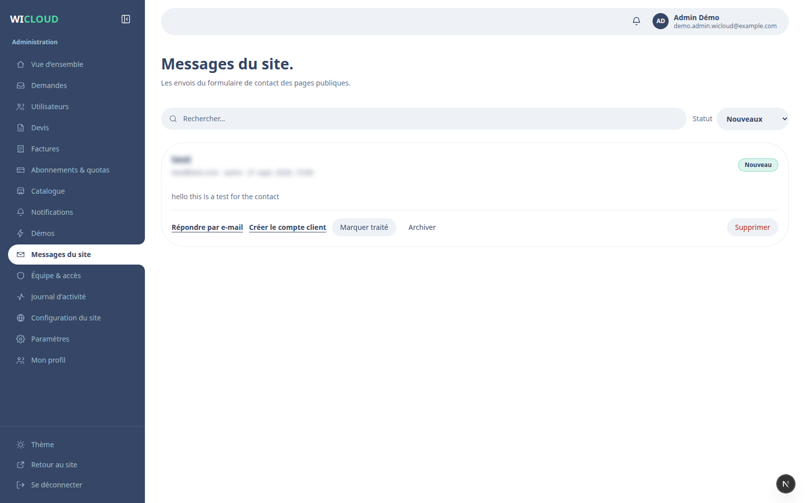

> 📷 Le nom et l'adresse du contact réel sont **floutés**.

La boîte de réception du formulaire de contact des pages publiques. Chaque message : nom, e-mail, solution concernée, texte, date. Statuts : `Nouveau`, `Traité`, `Archivé`. Actions : `Répondre par e-mail`, `Créer le compte client` *(qui relie le message au compte créé)*, supprimer.

## B11 — Équipe & accès

`/admin/equipe` · permission **`team:read`**

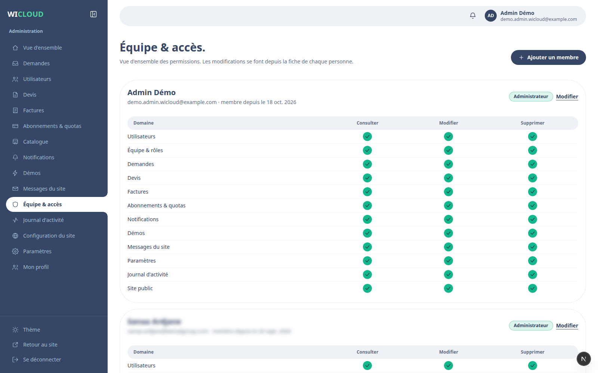

> 📷 Le membre réel de l'équipe est **flouté** ; la grille complète des 39 permissions reste lisible sur le compte de démonstration.

La **vue d'ensemble des permissions** : qui est dans l'équipe, avec quel rôle, et quels domaines chacun peut consulter, modifier ou supprimer. Les comptes suspendus sont signalés.

> **Cette page ne modifie rien** : elle affiche. Les changements se font sur la fiche de chaque personne (`Modifier`). Pour faire entrer quelqu'un dans l'équipe, passez son compte au rôle « Équipe » depuis *Utilisateurs*.

## B12 — Journal d'activité

`/admin/journal` · permission **`activity:read`**

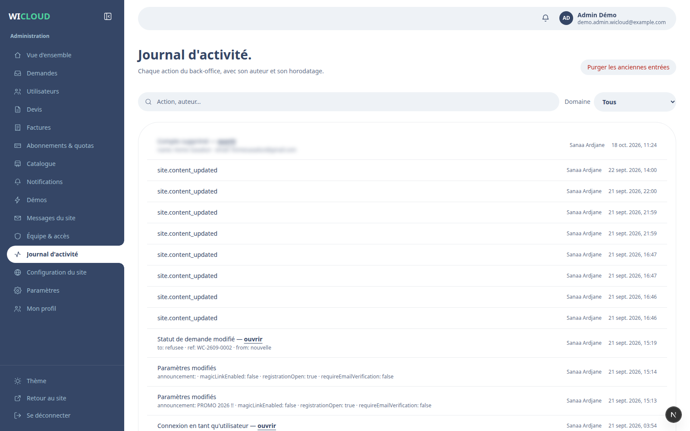

> 📷 Les auteurs réels sont **floutés**.

Chaque action du back-office, avec son auteur, son objet et son horodatage : changement de statut, envoi de document, suspension de compte, affichage de secret de démo, modification du site. Filtres par auteur, par type d'action et par période. Une **purge** est disponible pour les comptes qui en ont le droit.

## B13 — Configuration du site

`/admin/site` · permission **`site:read`** *(enregistrer : `site:write`)*

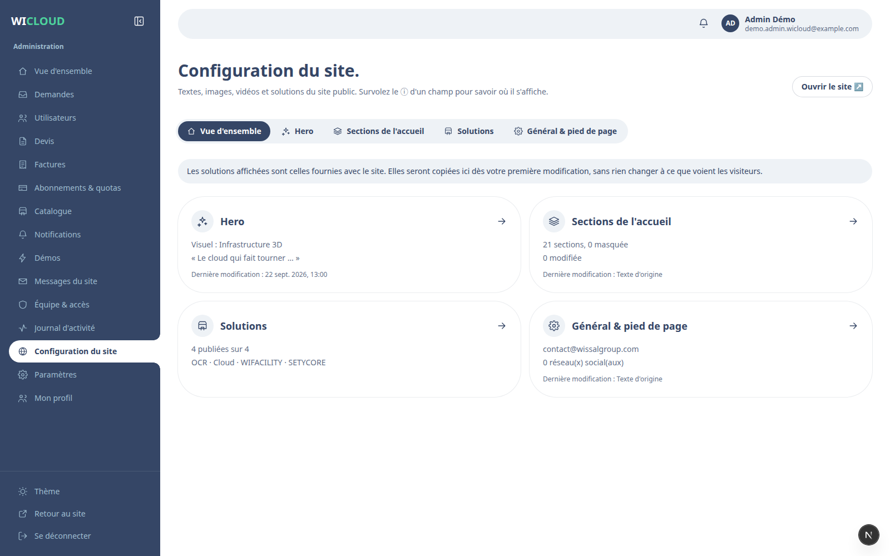

C'est ici que le site public s'édite, sans toucher au code. Un bouton `Ouvrir le site ↗` et, **sur chaque champ, une icône ⓘ qui dit où ce champ s'affiche** — avec un lien qui ouvre la page publique directement à la bonne section.

Cinq sous-onglets :

| Sous-onglet | Contenu |
| --- | --- |
| **Vue d'ensemble** | Des cartes de synthèse : mode du hero, nombre de sections modifiées ou masquées, solutions publiées, date de dernière modification. |
| **Hero** | Le premier écran : badge, titre, mots qui défilent, paragraphe, deux boutons, et le **visuel** — Terre 3D, Infrastructure 3D, Image, Vidéo ou Diaporama — ainsi que la **largeur** qu'il occupe. |
| **Sections de l'accueil** | Les 20 sections sous le hero, **dans l'ordre de la page**. Chacune s'ouvre, se modifie et **s'enregistre séparément** ; chacune peut être **masquée**, ce qui la retire du site. |
| **Solutions** | Chaque solution : tous ses textes et tous ses médias. On peut `Ajouter`, `Monter` / `Descendre` *(l'ordre ici est l'ordre partout sur le site : menu, carrousel, grilles, visuel 3D)*, publier / masquer, et supprimer. Une solution **créée est masquée** : on la remplit, puis on la publie. **Une solution masquée disparaît du site et sa page renvoie une erreur 404.** |
| **Général & pied de page** | Nom du site, titre et description de référencement, mots-clés, coordonnées, réseaux sociaux, et le contenu du pied de page. |

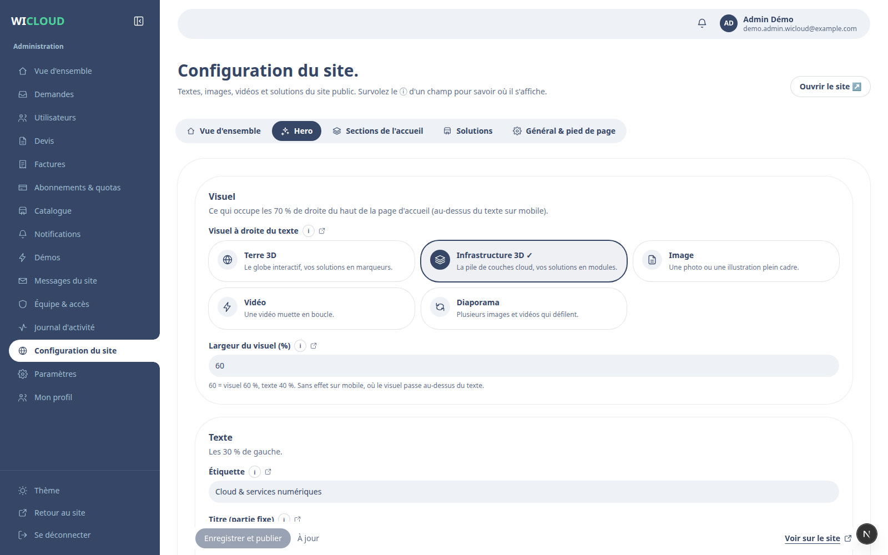

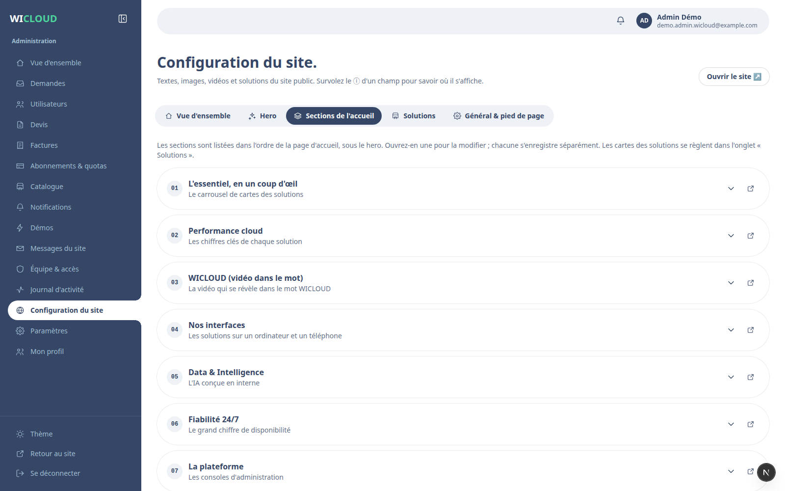

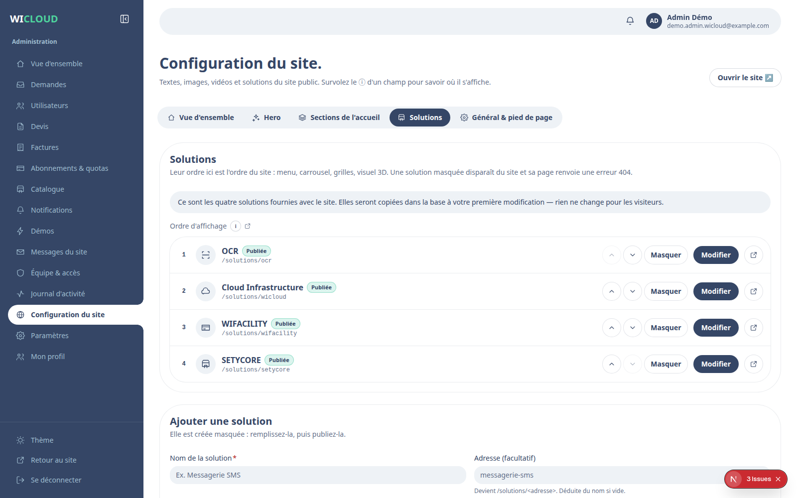

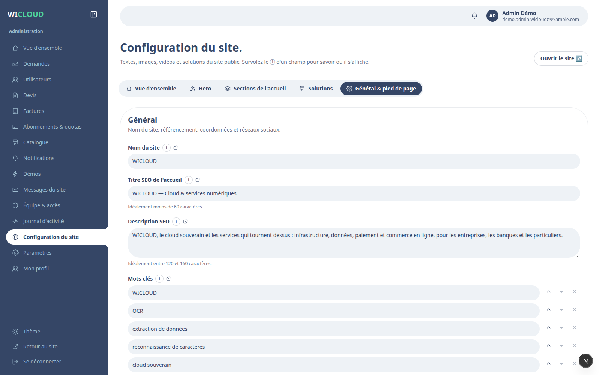

**Les médias** : chaque champ visuel accepte soit un **fichier téléversé** (jusqu'à 200 Mo, images et vidéos comprises), soit **un lien collé**. Un champ laissé vide revient au contenu d'origine livré avec le site — rien n'est jamais cassé par un champ vide.

> Les modifications apparaissent sur le site **immédiatement** après l'enregistrement.

## B14 — Paramètres

`/admin/parametres` · permission **`settings:read`** *(modifier : `settings:write`)*

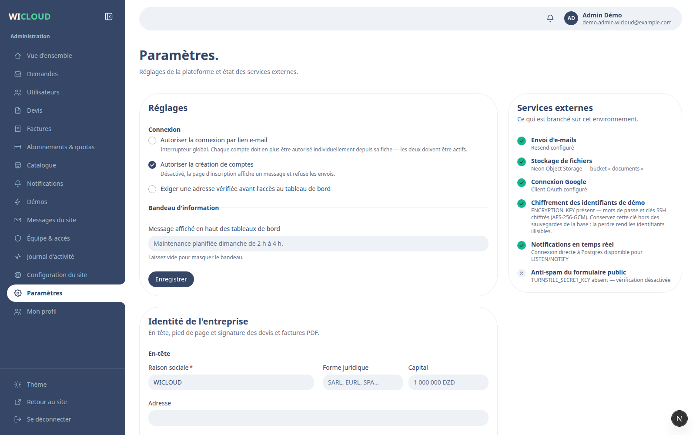

- **Réglages** : les options générales de la plateforme (dont l'ouverture de la connexion par lien magique).
- **Identité de l'entreprise** : en-tête, pied de page, mentions légales, coordonnées bancaires, TVA, logo et signature — **ce qui s'imprime sur les devis et les factures PDF**. Chaque champ reste réécrivable document par document.
- **Services externes** : l'état réel, en direct, de six dépendances :

| Service | S'il n'est pas configuré |
| --- | --- |
| **Envoi d'e-mails** | Les messages sont journalisés au lieu d'être expédiés — les liens de vérification et de réinitialisation y figurent, donc l'inscription reste possible sans boîte mail. |
| **Stockage de fichiers** | Les téléversements sont refusés proprement. |
| **Connexion Google** | Le bouton Google disparaît ; les autres méthodes fonctionnent. |
| **Chiffrement des identifiants de démo** | **Les secrets sont refusés** plutôt qu'enregistrés en clair. |
| **Notifications en temps réel** | Les notifications arrivent au rechargement de la page au lieu d'arriver seules. |
| **Anti-spam du formulaire public** | Le formulaire fonctionne sans vérification anti-robot. |

## B15 — Mon profil

`/admin/profil` · **aucune permission**

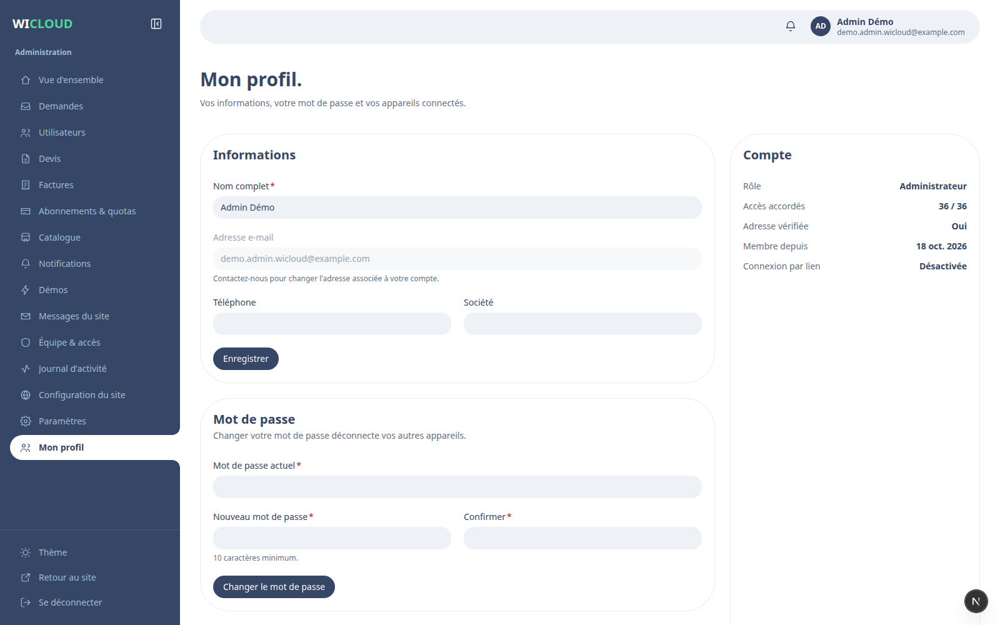

Identique au profil client — informations, mot de passe *(qui déconnecte les autres appareils)*, appareils connectés, rôle, **accès accordés**, adresse vérifiée, date d'arrivée, connexion par lien — plus une zone **« Supprimer mon compte »**.

> Un membre de l'équipe gère son compte **ici**, pas dans un espace client. Pour voir ce que voit un client, utilisez l'usurpation d'identité.

---

# Partie C — Les parcours courants

## C1 — D'un message public à un service en production

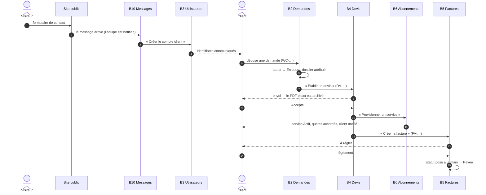

## C2 — Ouvrir une démo à un client

1. **B9 → Nouvelle démo** — elle naît en brouillon.
2. Empiler les blocs : le lien vers la plateforme, le compte de test, le guide.
3. Publier la démo.
4. **Accès** → accorder à un client nommé, avec une expiration si besoin.
5. Le client la voit dans **A3**, est notifié, et chaque affichage de secret apparaît dans **B12**.

## C3 — Faire entrer quelqu'un dans l'équipe

1. **B3 → Nouveau compte** (ou partir d'un compte client existant).
2. Sur sa fiche, passer le rôle à **Équipe** — il faut `team:write`.
3. Cocher, dans la grille, les permissions au-delà des quatorze par défaut — ou en retirer.
4. Vérifier le résultat dans **B11**.

## C4 — Modifier le site public

1. **B13 → Vue d'ensemble** pour repérer ce qui a déjà été modifié.
2. L'onglet correspondant : *Hero*, *Sections de l'accueil*, *Solutions* ou *Général*.
3. Le ⓘ de chaque champ dit où il s'affiche ; le lien ↗ ouvre la page à l'endroit exact.
4. Enregistrer — le site est à jour tout de suite.

---

## Annexe — Carte complète des pages

**Espace client (13 pages)**
`/dashboard` · `/dashboard/demandes` · `/dashboard/demandes/nouvelle` · `/dashboard/demandes/<id>` · `/dashboard/demos` · `/dashboard/demos/<slug>` · `/dashboard/abonnement` · `/dashboard/devis` · `/dashboard/devis/<id>` · `/dashboard/factures` · `/dashboard/documents` · `/dashboard/notifications` · `/dashboard/profil`

**Back-office (34 pages)**
`/admin` · `/admin/demandes` · `/admin/demandes/<id>` · `/admin/utilisateurs` · `/admin/utilisateurs/nouveau` · `/admin/utilisateurs/<id>` · `/admin/devis` · `/admin/devis/nouveau` · `/admin/devis/<id>` · `/admin/factures` · `/admin/factures/nouveau` · `/admin/factures/<id>` · `/admin/abonnements` · `/admin/abonnements/nouveau` · `/admin/abonnements/<id>` · `/admin/catalogue` · `/admin/catalogue/nouveau` · `/admin/catalogue/<slug>` · `/admin/notifications` · `/admin/notifications/envoyer` · `/admin/demos` · `/admin/demos/nouveau` · `/admin/demos/<id>` · `/admin/messages` · `/admin/equipe` · `/admin/journal` · `/admin/site` · `/admin/site/hero` · `/admin/site/accueil` · `/admin/site/solutions` · `/admin/site/solutions/<slug>` · `/admin/site/general` · `/admin/parametres` · `/admin/profil`

**Pages de connexion (7)**
`/connexion` · `/inscription` · `/mot-de-passe-oublie` · `/reinitialiser` · `/verification` · `/acces-refuse` · `/compte-suspendu`
