# WICLOUD — Technical Design Document

**System:** WICLOUD (repo `wisscreen`) — marketing site + client/back-office platform
**Scope of this document:** the whole platform, end to end
**Revision:** 2026-10-18 · analysed at commit `c71a9ae` · derived from the `.ua` knowledge graph (966 nodes / 2 871 edges / 10 layers) plus direct source reading
**Stack:** Next.js 16 (App Router, React 19, `output: "standalone"`) · TypeScript · Tailwind v4 + HeroUI v3 · Drizzle ORM · Neon Postgres (`node-postgres` pool) · Neon Object Storage (S3-compatible) · Better Auth · `@react-pdf/renderer` · GSAP / react-three-fiber · Docker (Node 22 Alpine) · GitHub Actions → Docker Hub

> **Reading note.** Every statement below is traceable to a file in this repo. Where a number is a *target* rather than something the code enforces today, it is marked **(proposed)** — the codebase defines no SLOs, and inventing them as facts would be worse than naming them as decisions still to be ratified.

---

## 0. The System, Drawn

**Start here.** This part draws the whole project — the marketing site included — so its shape can be read before any of the prose. Parts 1–7 then say why each piece is the way it is.

### 0.1 The URL surface — 56 routes, four groups

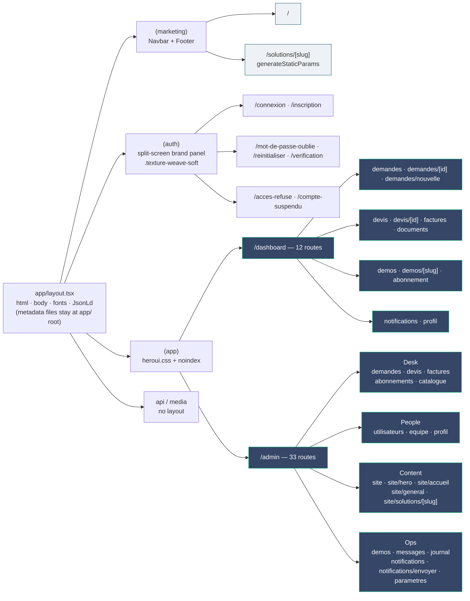

> `(marketing)` exists **so `Navbar`/`Footer` stop wrapping the dashboard**. No public URL changed when they moved: `app/(marketing)/page.tsx` is still `/`.

### 0.2 Rendering strategy — the decision, as a decision

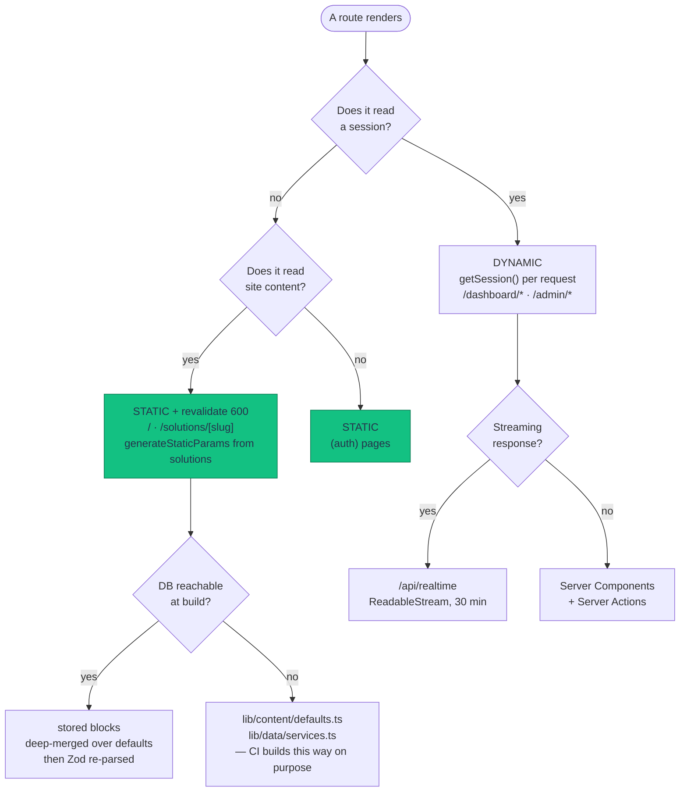

> The navbar's **`Connexion` link is a plain `href`** precisely to keep the left branch on the left: one session read there would turn the whole marketing site dynamic.

### 0.3 Where the public site's content comes from

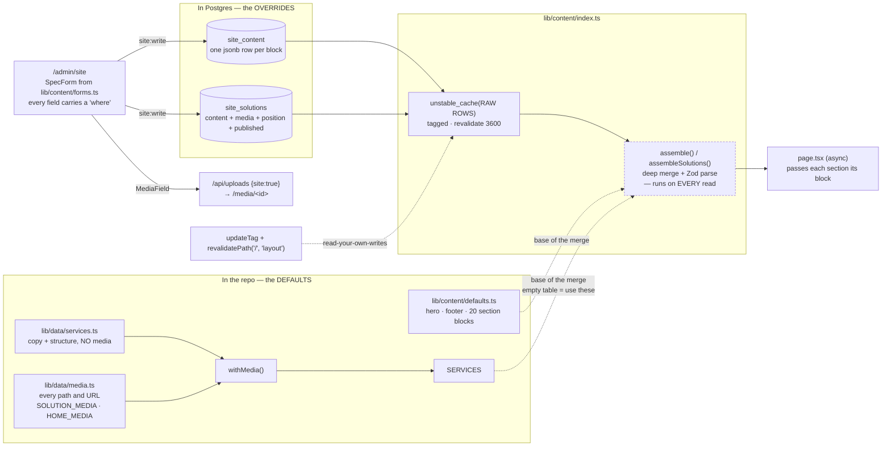

> **Only the raw rows are cached.** Caching the assembled object means a deploy that adds a field serves `undefined` until the entry expires — that shipped once and rendered a `NaN` into a grid template.

### 0.4 The homepage, in order — 22 sections and their ground rhythm

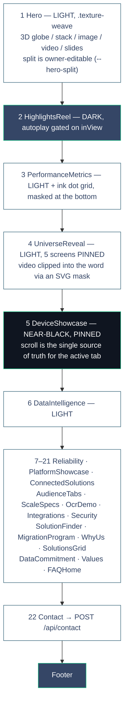

> Every section after the hero is skipped when its block carries `hidden: true` — the owner can empty the page from `/admin/site`. The light → light → dark → light run around `UniverseReveal` is the documented ceiling: **a third light section in a row is the point to revisit the rhythm.**

### 0.5 A solution page — 10 sections, one slug

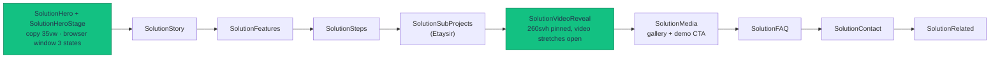

### 0.6 The three pinned-scroll sections, and how each is driven

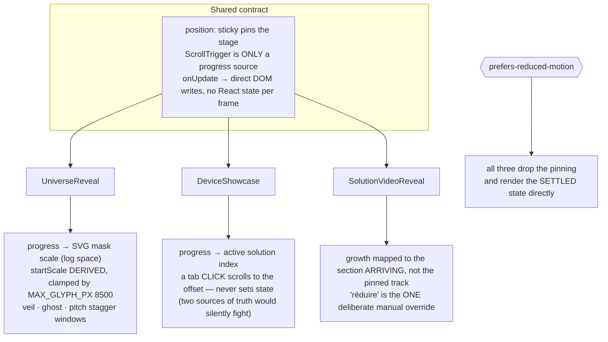

### 0.7 The module map — what `lib/` actually is

```mermaid
flowchart TB
    subgraph gate["Gate"]
        GUARD["guard.ts"] --> PERM["permissions.ts — can()"]
    end
    subgraph core["Domain"]
        REQ["requests.ts"]
        BILL["billing.ts · billing-lines.ts<br/>billing-preview.ts · billing-send.ts"]
        DEMO["demos.ts + server/demos.ts"]
        QUOTA["quotas.ts + quota-labels.ts"]
        ACCT["account.ts — notify · notifyMany · notifyStaff · logActivity"]
        COMP["company.ts — effectiveCompany()"]
        MONEY["money.ts — cents, withVat()"]
        REF["ref.ts"]
    end
    subgraph infra["Adapters"]
        DB["db/index.ts — lazy pool Proxy"]
        SCHEMA["db/schema.ts — 23 tables"]
        STORE["storage.ts — presign"]
        CRYPT["crypto.ts — AES-256-GCM"]
        MAIL["email.ts"]
        RT["realtime.ts"]
        PDF["pdf/BillingDocument.tsx"]
    end
    subgraph content["Public-site content"]
        CIDX["content/index.ts"] --> CSCH["content/schema.ts"]
        CIDX --> CDEF["content/defaults.ts"]
        CFORM["content/forms.ts — every field has a 'where'"]
    end

    GUARD --> DB
    ACCT --> RT
    ACCT --> DB
    BILL --> MONEY
    BILL --> COMP
    BILL --> PDF
    BILL --> STORE
    BILL --> MAIL
    DEMO --> CRYPT
    DEMO --> STORE
    QUOTA --> DB
    REQ --> REF
    CIDX --> DB
    SCHEMA --- DB

    NOTE["quota-labels.ts imports NO database —<br/>client components need the labels, and importing<br/>them from quotas.ts pulled pg into the browser bundle"]
    QUOTA -.-> NOTE
```

### 0.8 One file's journey — upload to presigned read

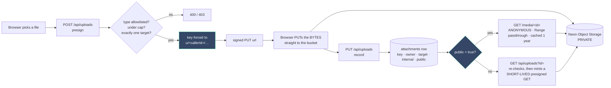

> The bytes never pass through Node in either direction, and the database never stores a URL — only a key — so a link that leaks expires.

### 0.9 The commercial lifecycle, as one picture

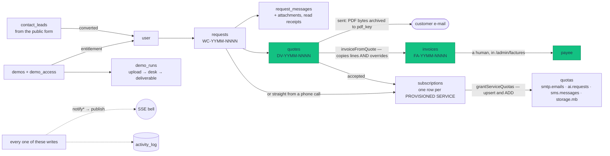

### 0.10 Permission matrix — 13 × 3

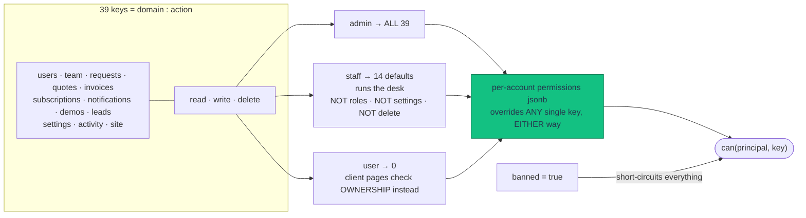

### 0.11 Cost of the system, at a glance

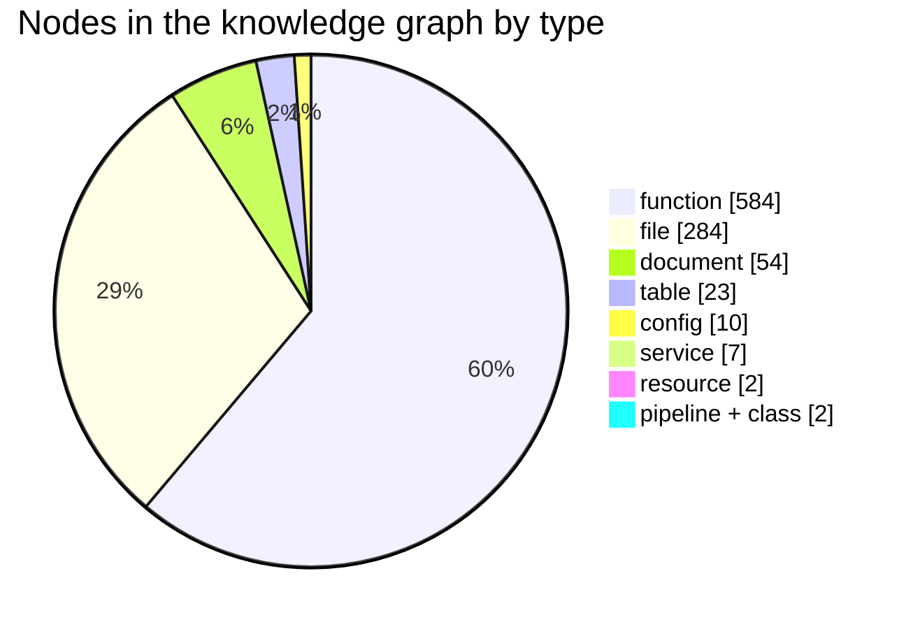

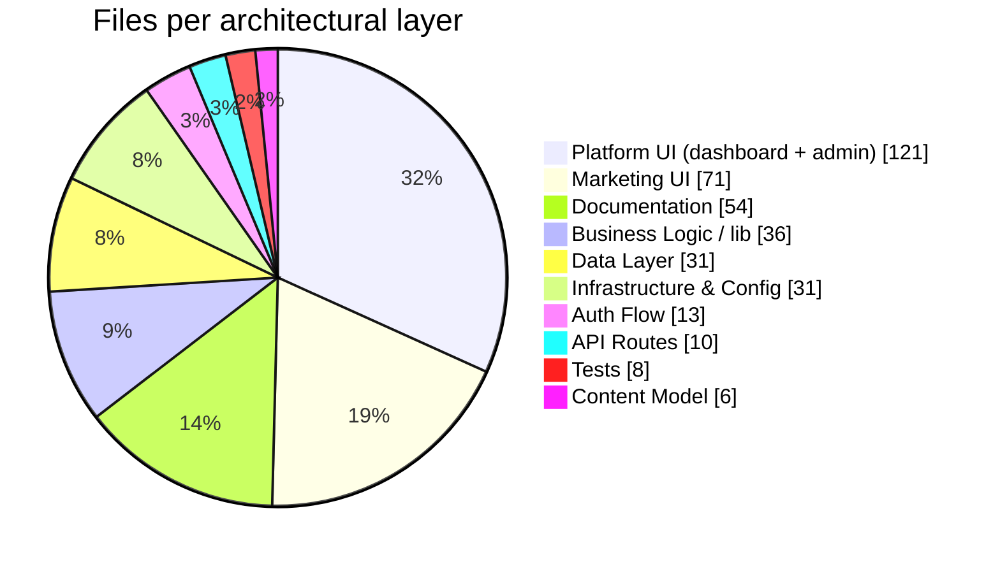

> Read those two together: **121 files of back-office UI against 8 files of test.** That ratio is the single most honest number in this document.

---

## 1. Executive Summary & Problem Scope

### 1.1 Feature overview

WICLOUD is one Next.js deployment serving three distinct audiences from one codebase: a statically-rendered French marketing site (long-form homepage + one sub-landing page per solution), a client space (`/dashboard`) where customers file requests, read quotes and invoices, open demos and watch their quotas, and a back-office (`/admin`) where the agency runs the desk and edits the public site's own content. A single Postgres database backs all three; a Postgres `LISTEN/NOTIFY` fan-out makes every signed-in page live.

### 1.2 Problem statement & business justification

| Friction before | What the platform does instead |
| --- | --- |
| The public contact form verified its captcha and then **dropped the message**, while telling the visitor it was "bien enregistré". | `POST /api/contact` writes a `contact_leads` row, notifies the desk through `notifyStaff("leads:read", …)` and e-mails the admin. The sentence the visitor reads is now true. |
| Marketing copy, media and the solution list lived in TypeScript files — every wording change was a deploy. | `/admin/site` edits `site_content` / `site_solutions`; `lib/data/*` became the *defaults* used before anything is saved and whenever the DB is unreachable (CI builds). |
| Quotes and invoices were ad-hoc documents; "what exactly did we send them?" was unanswerable after the lines were edited. | `lib/billing-send.ts` archives the exact PDF bytes (`pdfKey`) and attaches a client-visible copy at send time. |
| Demos were a simulator (`lib/demo.ts`) that hashed visitor input into plausible-looking output — a lie dressed as a product. | A demo is now authored content the owner **grants to a named customer** (`demos` + `demo_access`), with real links, real credentials (encrypted) and a real upload→deliverable loop. |
| A client filed a request and nothing appeared on the desk's screen until someone clicked. | SSE over Postgres `LISTEN/NOTIFY` — `lib/realtime.ts` + `/api/realtime`. |
| Role-based access alone forced a new role for every combination of capabilities. | `can()` in `lib/permissions.ts`: role defaults **plus** a per-account `permissions` jsonb that overrides individual keys either way. |

### 1.3 SLA & target metrics **(proposed — no SLO is encoded in the repo today)**

| Metric | Target | Basis / enforcement point |
| --- | --- | --- |
| Marketing pages p95 TTFB | ≤ 120 ms | `/` and `/solutions/[slug]` are statically rendered with `revalidate = 600`; no session is read in `(marketing)` so prerendering is preserved. |
| Dashboard page p95 | ≤ 450 ms | Every render calls `auth.api.getSession` (one DB round trip) before its own queries. |
| Dashboard page p99 | ≤ 900 ms | — |
| `POST /api/contact` p95 | ≤ 900 ms | Bounded by the Turnstile verify call, `AbortSignal.timeout(8000)`. |
| `/api/realtime` event delivery | ≤ 1 s publish→toast | `pg_notify` → dedicated `pg.Client` → in-process `Set<Listener>`. |
| Availability | 99.5 % monthly | Single container today; no multi-AZ. |
| Sustained throughput | 150 RPS/container **(proposed)** | Hard ceiling is the pool: **10** Postgres connections (`lib/db/index.ts`). |
| Concurrency ceiling, hard | 10 concurrent DB statements/container | The pool. The `LISTEN` client is deliberately **outside** it. |
| SSE connection lifetime | 30 min, 25 s heartbeat | `MAX_LIFETIME_MS` / `HEARTBEAT_MS` in `app/api/realtime/route.ts`. |
| Upload cap | 25 MB general · 200 MB site assets | `MAX_UPLOAD_BYTES` / `SITE_MAX_UPLOAD_BYTES` in `lib/storage.ts`. |
| Presigned GET validity | short-lived, minted per read | `presignDownload` — the DB stores the key, never a URL. |
| Magic-link validity | 600 s | `magicLink({ expiresIn: 60 * 10 })`. |
| Session lifetime | 30 days | `expiresIn: 60 * 60 * 24 * 30`. |

### 1.4 Scope boundaries

**In scope**

- Public marketing site (`app/(marketing)`), statically rendered, content-driven from the database with code defaults.
- Authentication: credentials, Google OAuth, magic link; e-mail verification and password reset.
- Authorization: `role` × per-account `permissions` jsonb, resolved by `can()`, enforced by `lib/guard.ts` **in every page and every server action**.
- Client space: requests + threaded messages, attachments, quotes, invoices, documents, demos, services and quotas.
- Back-office: the desk (requests, quotes, invoices, subscriptions, catalogue, users, permissions, demos, leads, activity log, settings) and `/admin/site` (public-site CMS).
- Billing documents as real PDFs, archived at send.
- Realtime fan-out (notifications, thread messages, row changes).
- Metered consumables (SMTP sends, AI requests, SMS, storage, bandwidth).
- Containerised build + CI/CD to Docker Hub.

**Out of scope (deliberate, with the consequence named)**

- **No payment provider.** An invoice's status is moved by a human in `/admin/factures`. `en_retard` is *derived* from `dueAt`, never written by a job.
- **No cron / scheduler anywhere.** Quota periods reset lazily inside `consume()`; overdue invoices are computed at read time. A container asleep all month behaves correctly on its first request.
- **No horizontal scale-out tested.** The design is multi-container-safe (Postgres fan-out, not an in-process emitter) but ships as one container.
- **No key rotation** for `ENCRYPTION_KEY`. The `v1:` prefix on every ciphertext is the seam; losing the key loses every demo secret, by design.
- **No WebSockets.** SSE is one-directional and needs no custom server, preserving `output: "standalone"`'s plain `node server.js`.
- **No separate BFF/API tier.** Server Components + Server Actions are the application boundary; Route Handlers exist only where an action cannot work (streaming, presigned URLs, `EventSource`, PDF bytes, anonymous access).
- **Broadcast is one row per recipient.** Fine into five figures; a segment join is the upgrade path.

---

## 2. Architecture & Container Topology

### 2.1 Container view

One Node container, four route groups, one database, one bucket. The layering below matches the knowledge graph's own 10 layers (Marketing UI 71 nodes · Platform UI 121 · Business Logic 36 · Data Layer 31 · API Routes 10 · Auth Flow 13 · Content Model 6 · Infra 31 · Docs 54 · Tests 8).

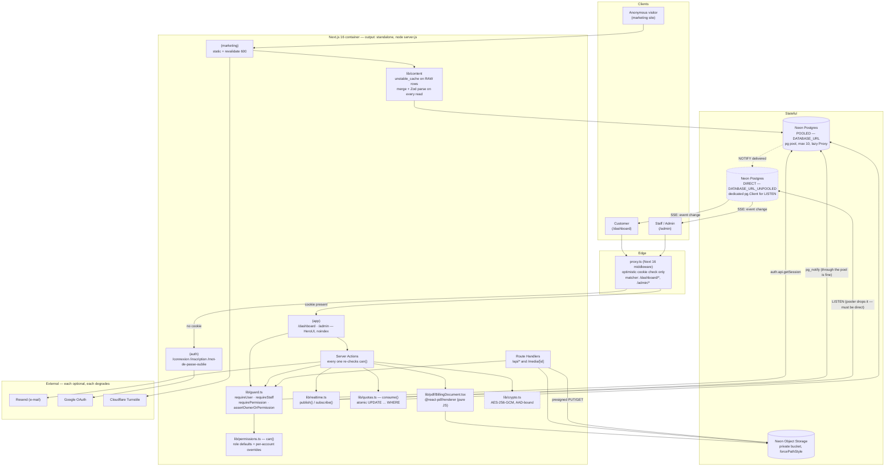

### 2.2 The decisions that shaped this topology

| Decision | Why, and what breaks without it |
| --- | --- |
| **`proxy.ts` decides nothing.** | It reads the cookie *by name* and bounces anonymous traffic before a dashboard render spins up. It does not validate, does not hit the DB, does not read a role. A proxy that trusts a cookie's existence is the bug that makes people believe they are protected. The real gate is `lib/guard.ts`, which calls `getSession` (a DB read) — so a session revoked a minute ago stops working immediately. |
| **The DB pool is a lazy `Proxy`.** | CI runs `pnpm build` with no `DATABASE_URL` and the Dockerfile passes no DB build-arg. A pool built at module scope fails the pipeline the moment a dashboard route imports it. `pnpm build` with the env file removed is part of the check. |
| **`node-postgres`, not `@neondatabase/serverless`.** | This ships as one long-lived Node container, so a real TCP pool against Neon's pooled endpoint beats per-request HTTP. |
| **`LISTEN` uses the *direct* endpoint.** | `DATABASE_URL` is PgBouncer in transaction mode: a `LISTEN` registers on a connection you no longer hold. Measured: **zero deliveries** through the pooler. `NOTIFY` through the pool is fine — it only needs to commit. |
| **The `LISTEN` client is never from the pool.** | A connection with a `LISTEN` registered can never be returned — the next borrower would silently inherit its notifications. Taking one of the ten would mean permanently losing it. |
| **HeroUI's stylesheet is imported only by `app/(app)/heroui.css`.** | Its component CSS is static, not JIT-purged: importing it globally took the marketing CSS from 13.5 KB to 49 KB gzipped. The cost of scoping is Tailwind preflight twice on dashboard documents — ~13 KB behind a login. |
| **`lib/content` caches the raw rows, never the assembled result.** | Caching the merged object means a deploy that adds a field serves `undefined` for it until the entry expires. That shipped once and rendered a `NaN` into a CSS grid template. Merge + Zod parse run on every read; the cached loaders *throw* on DB error so `unstable_cache` never pins the defaults for an hour. |
| **Marketing links to `/connexion` are plain `href`s.** | Reading a session in the navbar would opt `/` and `/solutions/*` out of static rendering. `/connexion` redirects an already-signed-in visitor, so the link is never wrong. |

---

## 3. Deep-Dive Interaction Flow (Sequence)

### 3.1 Happy path — a customer files a request, the desk is notified live, answers with a quote

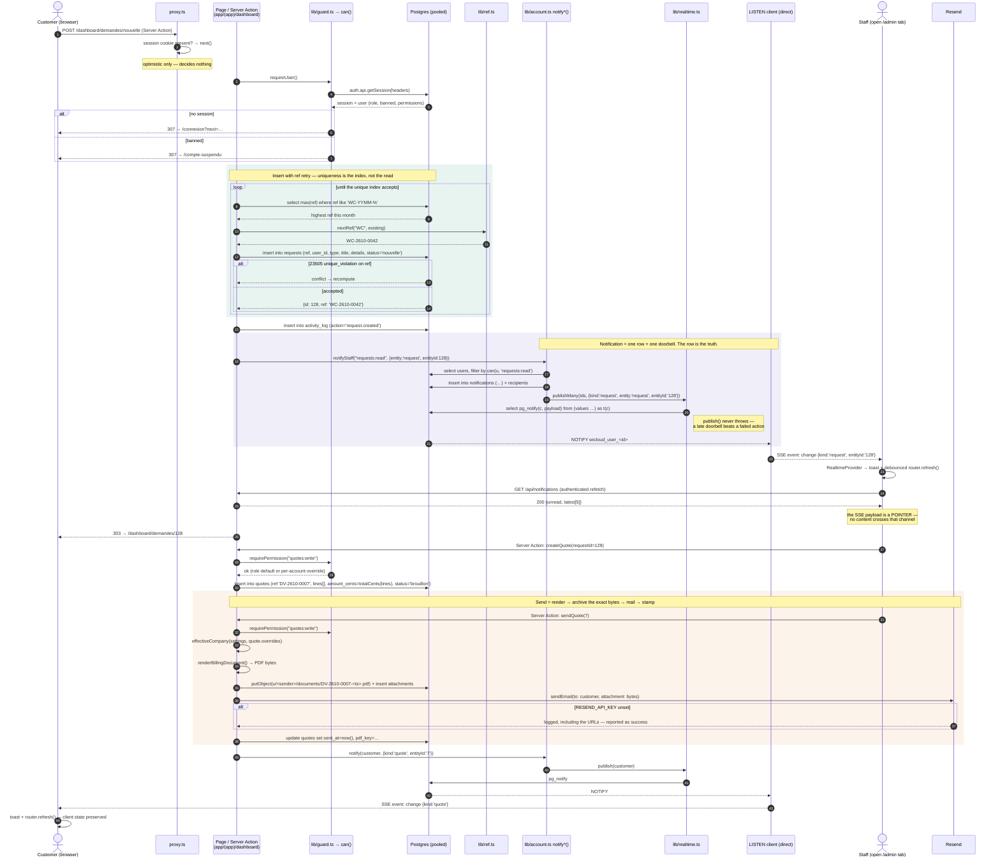

### 3.2 Second flow — revealing a demo secret (the most-checked path in the system)

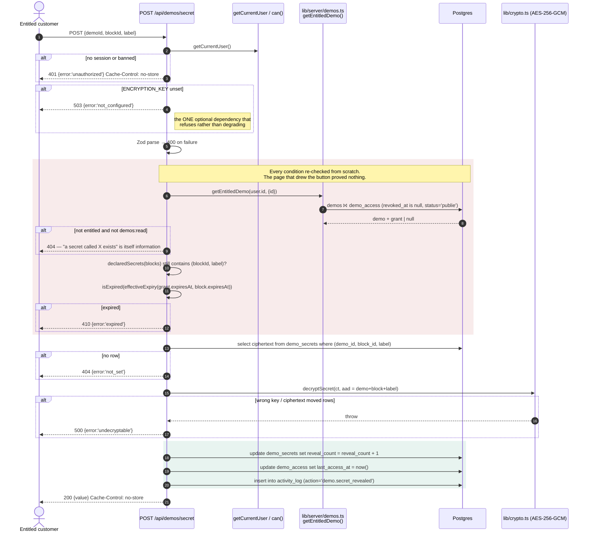

---

## 4. API & Interface Contracts

The application boundary is **Server Components + Server Actions**. A Route Handler exists only where an action cannot do the job. The ten that exist, and why each had to be a route:

| Method & URI | Auth | Exists as a route because |
| --- | --- | --- |
| `ALL /api/auth/[...all]` | — | Better Auth's own handler. |
| `POST /api/contact` | anonymous + Turnstile | Called from a public static page. |
| `GET /api/realtime` | session | `EventSource` needs a streaming response. |
| `GET /api/notifications` | session | Fetched by already-hydrated JS after an SSE pointer. |
| `GET /api/notifications/[id]/open` | session | Marks read **and** redirects. |
| `POST /api/uploads` · `PUT /api/uploads` · `GET /api/uploads?id=` | session | A presigned URL must exist *before* there is anything to submit. |
| `POST /api/demos/secret` | session | Returns a value to live JS, with its own `no-store`. |
| `GET /api/documents/[kind]/[id]` | session + ownership | Streams PDF bytes. |
| `GET /api/preview-status?url=` | — (allowlisted) | Framing headers are only readable server-side. |
| `GET /media/[id]` | **anonymous** | Public site assets out of a private bucket. |

### 4.1 `POST /api/contact`

```http
POST /api/contact
Content-Type: multipart/form-data
```

| Field | Type | Constraint |
| --- | --- | --- |
| `name` | string | trimmed, 1–200 |
| `email` | string | trimmed, RFC e-mail, ≤ 320 |
| `message` | string | trimmed, 1–5 000 |
| `solution` | string? | trimmed, ≤ 100 |
| `cf-turnstile-response` | string? | required **only when** `TURNSTILE_SECRET_KEY` is set |

```jsonc
// 200
{ "ok": true, "id": 42 }
// 400  Zod rejected the payload
{ "ok": false, "error": "invalid_input" }
// 403  Turnstile said no, or a token was required and absent
{ "ok": false, "error": "turnstile_failed" }
// 500  the DB write failed — the only case the visitor should retry
{ "ok": false, "error": "storage_failed" }
```

The e-mail is a convenience, not the record: a mail provider that is down must not turn a stored lead into an error the visitor retries.

### 4.2 `GET /api/realtime` — Server-Sent Events

```http
GET /api/realtime
Accept: text/event-stream
Cookie: better-auth.session_token=…
```

```http
200 OK
Content-Type: text/event-stream; charset=utf-8
Cache-Control: no-store, no-transform
Connection: keep-alive
X-Accel-Buffering: no
```

`no-transform` is the load-bearing half: a proxy that gzips this will buffer it, and a buffered event stream is not an event stream.

```
retry: 5000

event: unread
data: {"unread":3}

event: change
data: {"kind":"request","entity":"request","entityId":"128","at":1760000000000}

: ping 1760000025000
```

| Frame | Meaning |
| --- | --- |
| `retry: 5000` | Sent first. Without it the default 3 s makes a restart stampede every open tab. |
| `event: unread` | Sent on open so a tab left open overnight isn't stale until something happens to arrive. |
| `event: change` | The pointer. `kind ∈ notification \| message \| request \| quote \| invoice \| demo \| subscription`. |
| `: ping …` | A comment line — a valid frame that fires no handler. Every 25 s. |

**401, never a redirect.** This is a `fetch`; sending it to `/connexion` hands `EventSource` 200 of HTML to parse forever. Closes at 30 min; the browser reconnects itself. During impersonation this is the *impersonated* user's stream — which is what makes the client space look real from the inside.

### 4.3 `/api/uploads` — three steps, bytes never transit the app

```jsonc
// 1 — POST /api/uploads : presign
{ "filename": "devis.pdf", "contentType": "application/pdf", "size": 184320,
  "requestId": 128 }          // exactly ONE target: requestId | messageId | demoId | demoRunId | company | site
// 200
{ "key": "u/<callerId>/…/devis-1760000000000.pdf", "url": "https://…?X-Amz-Signature=…" }

// 2 — the browser PUTs the bytes straight to that URL

// 3 — PUT /api/uploads : record
{ "key": "u/<callerId>/…", "filename": "devis.pdf", "contentType": "application/pdf",
  "size": 184320, "requestId": 128, "internal": false }
// 200 { "id": 91 }
```

| Code | Condition |
| --- | --- |
| `400` | Zod failure, disallowed content type, over cap, or **more than one target** (`"ambiguous"`) |
| `401` | no session / banned |
| `403` | not permitted on that target |
| `404` | target row does not exist |
| `503` | `storageConfigured()` is false |

Invariants the presign step enforces, because handing out a signed PUT is handing out write access to the bucket:

- the key is **always** built under `u/<the caller's own id>/` — a client cannot name the key, so nobody can overwrite another account's object;
- the content type is checked against `ALLOWED_CONTENT_TYPES` (`image/svg+xml` is deliberately **out**: it is script-capable, and the disposition is the only line between it and a stored XSS);
- the size is checked against 25 MB, or 200 MB for `site: true`.

Per-target authorization:

| Target | May attach | May read |
| --- | --- | --- |
| `request` | its client, or `requests:write` | its client (not `internal`), or `requests:read` |
| `message` | as its request | as its request |
| `demo` | `demos:write` | anyone entitled, or `demos:read` |
| `demoRun` | its customer, or `demos:write` | its customer (not `internal`), or `demos:read` |
| `company` | `settings:write` | `settings:read` |
| `site` | `site:write` | **anyone**, via `/media/<id>` |

> A demo asset is owned by the admin who wrote it, which is exactly why `GET` cannot decide on `ownerId` alone.

### 4.4 `POST /api/demos/secret`

```jsonc
// request
{ "demoId": 3, "blockId": "0f0e…uuid", "label": "Mot de passe" }
// 200
{ "value": "…" }                      // Cache-Control: no-store on every response
```

| Code | Meaning |
| --- | --- |
| `400` | `invalid_input` |
| `401` | `unauthorized` |
| `404` | `not_found` (not entitled · block no longer declares it · demo gone) / `not_set` |
| `410` | `expired` — grant expiry ∧ block expiry, whichever is sooner |
| `500` | `undecryptable` — wrong key, or a ciphertext moved between rows (the AAD catches it) |
| `503` | `not_configured` — `ENCRYPTION_KEY` unset |

### 4.5 `GET /api/preview-status?url=…`

Answers one boolean: may this URL be framed? `X-Frame-Options` and CSP `frame-ancestors` are only readable server-side — nothing the browser exposes to the parent distinguishes "loaded cross-origin" from "refused" (measured in Chrome: both fire `load`, both return `null` from `contentDocument`, both throw from `contentWindow.location`). Cached 10 minutes.

**The `url` must already appear in `SERVICES`.** An endpoint that fetched whatever it was handed would be an open SSRF proxy; the allowlist is the only thing stopping that. Keep it.

### 4.6 `GET /media/[id]`

The only anonymous read out of a private bucket. Streams **only** attachments with `public = true` and an image/video content type, passes `Range` through (video seeking; Safari needs 206) and caches for a year because ids are immutable. Everything else stays behind `/api/uploads`' checks.

### 4.7 Event contract (`lib/realtime.ts`)

| Property | Value |
| --- | --- |
| Transport | Postgres `LISTEN/NOTIFY` → SSE |
| Channel (partition key) | `wicloud_user_<sanitised userId>` — one channel per account |
| Publisher | `publish()` / `publishMany()`, through the **pooled** connection |
| Subscriber | one dedicated `pg.Client` on the **direct** endpoint, per container |
| Payload cap | 8 000 bytes (Postgres) — never reached: the payload is a pointer |
| Delivery | at-most-once, best effort. The `notifications` row is the durable record |
| Backoff | 1 s → ×2 → 30 s cap on connection loss, then `resubscribeAll()` |

```jsonc
{ "kind": "notification", "entity": "request", "entityId": "128", "id": 412, "at": 1760000000000 }
```

`LISTEN` takes an identifier and cannot be parameterised — `channelFor()` strips everything but `[A-Za-z0-9_]` and `quoteIdent()` is the second line of defence.

---

## 5. Business Logic, State Machine & Edge Cases

### 5.1 `requests` — the primary domain entity

Transitions are guarded by `nextStatuses()` / `canTransition()` in `lib/requests.ts`, never by free assignment.

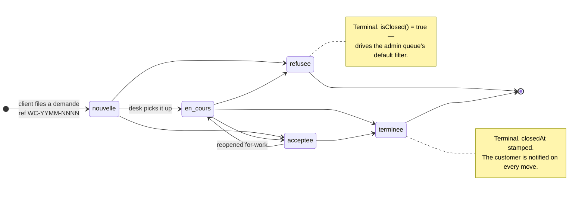

### 5.2 `quotes` and `invoices`

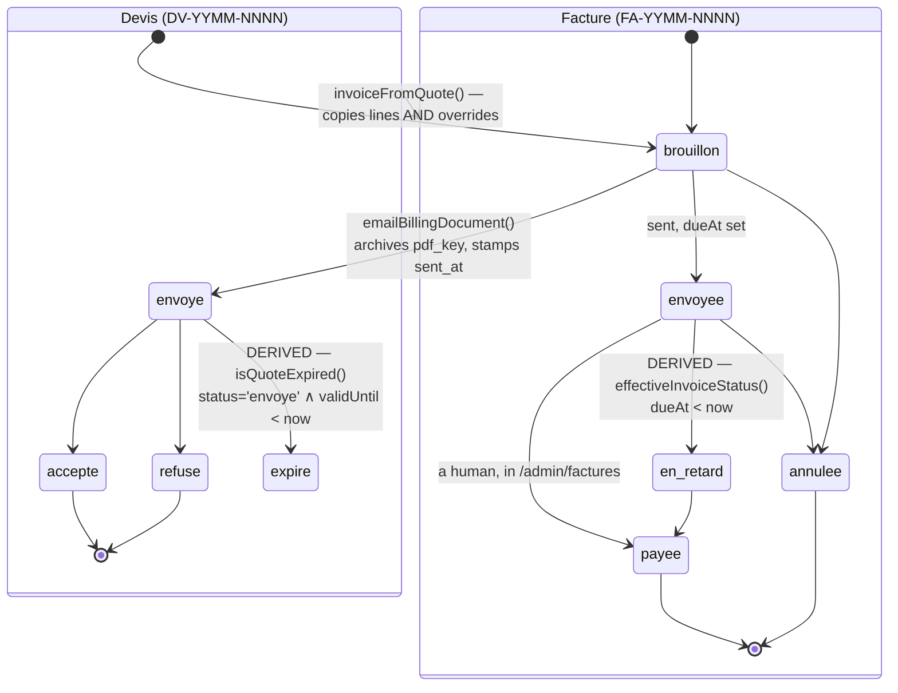

**`expire` and `en_retard` are derived, not stored.** `isQuoteExpired()` and `effectiveInvoiceStatus()` compute them at read time: there is no job to forget to run, the answer is always current, and the alternative — a component calling `Date.now()` during render — is impure and caught by React's own lint rule.

### 5.3 `subscriptions`, `demos`, `demo_runs`

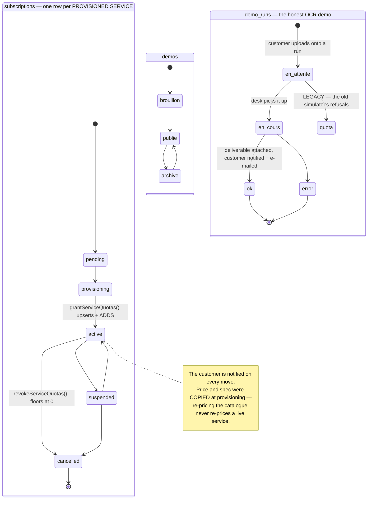

### 5.4 Invariants and validation rules

| Rule | Where enforced | Why it is there |
| --- | --- | --- |
| Reference codes `WC-/DV-/FA-YYMM-NNNN`, `/^[A-Z]{2}-\d{4}-(\d{4})$/` | `lib/ref.ts` + a **unique index** | Two concurrent inserts can compute the same ref. The index guarantees uniqueness; the caller retries (`insertWithRef`). |
| Money is integer **cents**, currency in its own column | schema-wide; `lib/money.ts` is the only file where a decimal appears | Never a float, never a Postgres `numeric` that returns a string and gets `parseFloat`ed somewhere downstream. |
| `amountCents` = `totalCents(lines)`, recomputed on every write | billing actions | A denormalised sum that can drift is worse than no sum. |
| TTC = `withVat(cents, rate)`, one formula | `lib/money.ts` | The PDF, `MoneyLines`, the customer totals and the e-mail body all call it, so they cannot disagree. |
| VAT and every printed company field are **per document** | `quotes.overrides` / `invoices.overrides` → `effectiveCompany()` | VAT differs per document, so client totals are computed per row. Anything that prints or totals must go through the effective identity, never `getCompany()` alone. |
| Password: ≥ 10 chars + one per class, ambiguous glyphs excluded | `lib/password.ts`, re-checked server-side in `auth.hooks.before` on `/sign-up/email` and `/reset-password` | A disabled button is not a control; those are public endpoints. `O/0`, `l/1/I`, `|` are out of every set because an admin reads these aloud. `__tests__/password.test.ts` runs the generator 500×. |
| `minPasswordLength: 10` matches the length rule | `lib/auth.ts` | Raise both together or Better Auth's own error fires first with a different message. |
| Nobody acts on their own account | admin server actions | — |
| The **last active admin** cannot be demoted, suspended or deleted | a `count(*)` query, not a hardcoded e-mail | The lockout this prevents is unrecoverable from inside the app. |
| Only `team:write` may change roles or permissions | admin server actions | Separates "runs the desk" from "changes who runs the desk". |
| Row ownership answers `notFound()`, not 403 | `assertOwnerOrPermission` | Telling a stranger that request 9999 exists is itself a leak. |
| Demo block ids are **uuids minted on add**, never indexes | `lib/demos.ts` + `demo_secrets.block_id` | Reordering blocks must not re-point a password at a different server. |
| Secrets never live in a block | `demo_secrets`, AAD = demo+block+label | The admin list selects demos wholesale and the editor is a client component — a secret inside the jsonb would reach both. A ciphertext copied to another row fails loudly. |
| HTML demo blocks render in `<iframe sandbox="">` | `DemoBlocks.tsx` | `demos:write` can be granted to one staff member and must not also be a way to run script in a customer's session. |
| Upload: one target only, allowlisted type, key under `u/<callerId>/` | `/api/uploads` | See §4.3. |
| `Checkbox` from HeroUI is banned | `CheckboxField` in `components/dashboard/ui.tsx` | Measured: HeroUI's is a pure ARIA widget rendering **no `<input name>`**, so every flag posted as `undefined`. Every settings switch and "note interne" was permanently false. |

### 5.5 Failure modes & edge cases

| Scenario | Handling | Residual risk |
| --- | --- | --- |
| **Ref collision under concurrency** | Unique index rejects, `insertWithRef` recomputes and retries. | A pathological burst retries more than once. `lib/ref.ts` carries a `ponytail:` note: move to a per-prefix sequence if the desk ever outpaces it. |
| **Two concurrent consumptions of the same quota** | `consume()` makes the increment **and** the guard one `UPDATE … WHERE base + amount <= limit`; an update that matches no row *is* the refusal. A read-then-write lets two runs both see 19/20 and both pass. | None at the row level. |
| **Quota period expired while the container slept** | `consume()` notices `resetsAt <= now` and zeroes the counter in the same statement. No cron. | A month of inactivity leaves `resetsAt` stale until the first request — harmless, since the reset is applied before the check. |
| **An action fails *after* `consume()` succeeded** | `refund()` gives the allowance back, flooring at 0. | Not transactional with the action — a crash between the two leaks one unit. Acceptable: the metrics are sends and requests, not money. |
| **`publish()` fails** (DB blip, `pg_notify` error) | Caught and warned, never rethrown. The `notifications` row is already written — the row is the truth, this is the doorbell. | The recipient sees it on the next navigation instead of instantly. |
| **`LISTEN` connection dropped** (Neon closes idle, deploy restarts PG) | `drop()` clears the client; exponential backoff 1 s → ×2 → 30 s cap, then `resubscribeAll()` re-issues every `LISTEN` the live subscribers still need. | Events published during the gap are lost — by design, at-most-once. The durable row survives. |
| **One SSE subscriber throws** | Caught per-listener inside the `notification` handler. | One subscriber throwing must not cost the others their event. |
| **Someone opens three tabs** | Three listeners on one channel; `UNLISTEN` fires only when the **last** one goes away. | — |
| **Turnstile unset** | `verifyTurnstile` returns `true` — the form behaves exactly as it did before Turnstile existed, rather than rejecting every submission. | Spam, until the keys are added. Both keys land in `.env.local` together. |
| **Resend unset** | `sendEmail` logs the message **including the verification and reset URLs** and reports success. | That is what makes the whole sign-up flow completable with no mailbox. |
| **`ENCRYPTION_KEY` unset** | `POST /api/demos/secret` → `503 not_configured`. | **The one optional dependency that does not degrade to a lesser feature.** Refusing beats storing secrets in the clear. |
| **Storage unset** | `storageConfigured()` false → `503`; `/admin/parametres` renders the live state of all four externals so the gap is never silently assumed. | — |
| **A framed preview host refuses** | `/api/preview-status` decided it server-side *before mount*; the frame falls back to `showcaseImage`, then to a generated mock. | A refused frame paints an **opaque** Chrome error page, so letting a fallback show through a transparent frame was never an option. |
| **`previewUrl` points at this origin** | It frames itself, recurses and hangs the tab. | Documented; not guarded in code. |
| **Suspended account with a live session** | `can()` returns `false` for a `banned` principal whatever the role says — the second line behind Better Auth's own refusal, for a session minted before the ban landed. | — |
| **DB unreachable during a marketing render** | The cached loaders throw, the fallback to `lib/data/*` defaults sits **outside** the cache. `unstable_cache` doesn't store a thrown result, so an outage never pins the defaults for an hour. | — |
| **Build with no `DATABASE_URL`** (CI, Docker) | Lazy pool `Proxy`; lazy `LISTEN` client; `getSolutions()` falls back to `SERVICES`. `pnpm build` with the env file removed is part of the check. | — |
| **Dead-letter / retry queue** | **None.** There is no queue, no DLQ and no background worker anywhere in this system. | Every failure is surfaced synchronously to the actor or written to `activity_log`. If an async pipeline is ever introduced, this row becomes a real design question. |

---

## 6. Data Modeling & Storage Strategy

### 6.1 Entity relationships

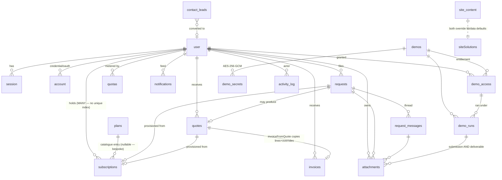

### 6.2 DDL — the load-bearing tables

```sql
-- Identity. Everything after `permissions` is ours, declared through Better
-- Auth's user.additionalFields so TS and SQL stay in step.
CREATE TABLE "user" (
  id                   text PRIMARY KEY,
  name                 text NOT NULL,
  email                text NOT NULL UNIQUE,
  email_verified       boolean NOT NULL DEFAULT false,
  image                text,
  role                 text NOT NULL DEFAULT 'user',   -- user | staff | admin
  banned               boolean DEFAULT false,
  ban_reason           text,
  ban_expires          timestamp,
  permissions          jsonb,          -- {"invoices:write": true, "leads:read": false}
  magic_link_enabled   boolean NOT NULL DEFAULT false,
  phone                text,
  company              text,
  admin_note           text,           -- staff-visible only
  last_seen_at         timestamp,
  created_at           timestamp NOT NULL,
  updated_at           timestamp NOT NULL
);
CREATE INDEX user_role_idx ON "user" (role);

-- One row per PROVISIONED SERVICE. The unique index on user_id is gone,
-- deliberately: a customer holds a server AND an SMTP allowance AND an AI plan.
CREATE TABLE subscriptions (
  id              serial PRIMARY KEY,
  user_id         text NOT NULL REFERENCES "user"(id) ON DELETE CASCADE,
  plan_slug       text REFERENCES plans(slug) ON DELETE SET NULL,  -- null = bespoke
  label           text,
  request_id      integer REFERENCES requests(id) ON DELETE SET NULL,
  quote_id        integer REFERENCES quotes(id)   ON DELETE SET NULL,
  price_cents     integer,              -- COPIED at provisioning, then owned here
  currency        text NOT NULL DEFAULT 'DZD',
  billing_period  text NOT NULL DEFAULT 'monthly',
  resource_spec   jsonb NOT NULL DEFAULT '{}',
  access_notes    text,                 -- panel URL, IP, hostname. NEVER a password
  status          text NOT NULL DEFAULT 'pending',
  period_start    timestamp NOT NULL DEFAULT now(),
  period_end      timestamp,
  renews_at       timestamp,            -- no payment provider: a human watches this
  cancel_at_period_end boolean NOT NULL DEFAULT false,
  note            text,
  created_at      timestamp NOT NULL DEFAULT now(),
  updated_at      timestamp NOT NULL DEFAULT now()
);
CREATE INDEX subscriptions_user_idx   ON subscriptions (user_id);
CREATE INDEX subscriptions_status_idx ON subscriptions (status);

-- Metered consumables. limit NULL = unlimited; limit 0 = NOT INCLUDED (a
-- different message, distinguishable at the call site).
CREATE TABLE quotas (
  id         serial PRIMARY KEY,
  user_id    text NOT NULL REFERENCES "user"(id) ON DELETE CASCADE,
  metric     text NOT NULL,          -- smtp.emails | ai.requests | sms.messages | storage.mb | …
  "limit"    integer,
  used       integer NOT NULL DEFAULT 0,
  resets_at  timestamp,              -- NULL = standing allowance (storage.*)
  updated_at timestamp NOT NULL DEFAULT now()
);
CREATE UNIQUE INDEX quotas_user_metric_key ON quotas (user_id, metric);  -- the upsert target

CREATE TABLE requests (
  id            serial PRIMARY KEY,
  ref           text NOT NULL UNIQUE,     -- WC-YYMM-NNNN — THIS is the uniqueness guarantee
  user_id       text NOT NULL REFERENCES "user"(id) ON DELETE CASCADE,
  service_slug  text,                     -- no FK: the solutions list is a code file
  type          text NOT NULL DEFAULT 'service',   -- service|demo|devis|support
  title         text NOT NULL,
  details       text NOT NULL,
  status        text NOT NULL DEFAULT 'nouvelle',
  priority      text NOT NULL DEFAULT 'normale',
  assigned_to_id text REFERENCES "user"(id) ON DELETE SET NULL,
  budget_cents  integer,
  created_at    timestamp NOT NULL DEFAULT now(),
  updated_at    timestamp NOT NULL DEFAULT now(),
  closed_at     timestamp
);
CREATE INDEX requests_user_idx   ON requests (user_id);
CREATE INDEX requests_status_idx ON requests (status);

CREATE TABLE quotes (
  id           serial PRIMARY KEY,
  ref          text NOT NULL UNIQUE,                  -- DV-YYMM-NNNN
  user_id      text NOT NULL REFERENCES "user"(id) ON DELETE CASCADE,
  request_id   integer REFERENCES requests(id) ON DELETE SET NULL,
  title        text NOT NULL,
  lines        jsonb NOT NULL DEFAULT '[]',           -- {label, quantity, unitCents}[]
  amount_cents integer NOT NULL DEFAULT 0,            -- = totalCents(lines), HT
  currency     text NOT NULL DEFAULT 'DZD',
  status       text NOT NULL DEFAULT 'brouillon',
  valid_until  timestamp,
  note         text,
  overrides    jsonb NOT NULL DEFAULT '{}',           -- per-document company identity + VAT
  pdf_key      text,                                  -- the EXACT bytes the client was sent
  sent_at      timestamp,
  created_by_id text REFERENCES "user"(id) ON DELETE SET NULL,
  created_at   timestamp NOT NULL DEFAULT now(),
  updated_at   timestamp NOT NULL DEFAULT now()
);
CREATE INDEX quotes_user_idx ON quotes (user_id);
-- invoices is the same shape plus quote_id, issued_at, due_at, paid_at.

-- Entitlement. A re-grant after a revoke is an UPSERT on this key, not a second row.
CREATE TABLE demo_access (
  id            serial PRIMARY KEY,
  demo_id       integer NOT NULL REFERENCES demos(id)  ON DELETE CASCADE,
  user_id       text    NOT NULL REFERENCES "user"(id) ON DELETE CASCADE,
  granted_by_id text REFERENCES "user"(id) ON DELETE SET NULL,
  note          text,
  expires_at    timestamp,       -- can only SHORTEN the demo's own
  revoked_at    timestamp,       -- soft: "we did once hand this to him" matters
  last_access_at timestamp,      -- stamped on reveal/run only, NEVER on a page render
  created_at    timestamp NOT NULL DEFAULT now()
);
CREATE UNIQUE INDEX demo_access_demo_user_key ON demo_access (demo_id, user_id);
CREATE INDEX demo_access_user_idx ON demo_access (user_id);

CREATE TABLE demo_secrets (
  id           serial PRIMARY KEY,
  demo_id      integer NOT NULL REFERENCES demos(id) ON DELETE CASCADE,
  block_id     text NOT NULL,     -- the block's own uuid, NEVER its index
  label        text NOT NULL,
  ciphertext   text NOT NULL,     -- v1:<iv>:<tag>:<ct>, base64url, AES-256-GCM
  reveal_count integer NOT NULL DEFAULT 0,
  created_by_id text REFERENCES "user"(id) ON DELETE SET NULL,
  created_at   timestamp NOT NULL DEFAULT now(),
  updated_at   timestamp NOT NULL DEFAULT now()
);
CREATE UNIQUE INDEX demo_secrets_block_label_key ON demo_secrets (demo_id, block_id, label);

CREATE TABLE notifications (
  id         serial PRIMARY KEY,
  user_id    text NOT NULL REFERENCES "user"(id) ON DELETE CASCADE,
  type       text NOT NULL DEFAULT 'system',
  title      text NOT NULL,
  body       text,
  href       text,                -- in-app destination only
  actor_id   text REFERENCES "user"(id) ON DELETE SET NULL,
  entity     text,
  entity_id  text,
  read_at    timestamp,
  created_at timestamp NOT NULL DEFAULT now()
);
CREATE INDEX notifications_user_unread_idx ON notifications (user_id, read_at);
```

### 6.3 Modelling decisions worth defending

| Choice | Rationale |
| --- | --- |
| **jsonb for `demos.blocks`, `quotes.lines`, `plans.specs`, `site_*.value`** | A new demo block kind is a type member + a Zod member + an editor case + a renderer case — **never a migration, never a backfill**. A column per kind is endless; one `kind` column per demo would mean three demos for one deliverable. The shapes are Zod-validated at the boundary, so "schemaless" never reaches the renderer. |
| **No `demo_runs.result_attachment_id`** | Submission vs deliverable follows from `attachments.uploaded_by_id`. The alternative makes the two tables reference each other in a cycle. |
| **`request_messages.read_at` is one timestamp, not a per-viewer table** | A request thread has exactly two sides. |
| **`demo_runs.service_slug` is denormalised with no FK** | A label that outlives the demo — the same reasoning `invoiceFromQuote` uses when it copies `quote.lines` instead of referencing them. |
| **`quotas.metric` is free text** | A new metered service is a label, not a migration. The vocabulary lives in `lib/quota-labels.ts`, which imports no database — client components need the labels, and importing them from `quotas.ts` pulled `pg` into the browser bundle. |
| **`plans` keeps its old name and `default_quotas` column** | Repurposing three pricing tiers into a service catalogue needed no destructive rename. The name is historical; it is a *grant*, not a default. |
| **The bucket stores keys, never URLs** | Every read mints a short-lived presigned GET, so a leaked link expires. Uploads are presigned PUTs straight from the browser — bytes never enter the Node process. |
| **`attachments.public` gates `/media/<id>`** | The only anonymous path out of a private bucket, and it is one boolean wide. |

### 6.4 Migrations

`pnpm db:generate` / `db:migrate`, run **by hand** against Neon, never from the app's start command. They use `DATABASE_URL_UNPOOLED`: DDL through a transaction pooler trips `prepared statement already exists`. The `db:*` scripts get their env from Node's own `--env-file=.env.local` — there is no `dotenv` dependency.

---

## 7. Security, Observability, Deployment & Rollout

### 7.1 Authorization model

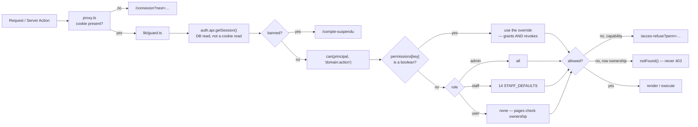

13 domains × 3 actions = **39 permission keys**. `staff` defaults to 14 of them: it runs the desk (read everything operational, answer and move requests, draft quotes and invoices) but cannot touch roles, settings, or delete anything — the three things that are hard to undo start off and are granted per person.

**Every server action re-checks.** An action is a public endpoint; the page having rendered the control is not an authorization.

### 7.2 Security posture

| Control | Implementation |
| --- | --- |
| Secrets at rest | AES-256-GCM, `v1:` versioned, AAD = demo+block+label so a ciphertext copied to another row fails loudly. |
| Secrets in transit to the UI | Fetched one at a time on click, `Cache-Control: no-store`, every reveal written to `activity_log`. |
| Object storage | Private bucket, `forcePathStyle: true`; presigned PUT (key forced under `u/<callerId>/`) and short-lived presigned GET. |
| SSRF | `/api/preview-status` accepts only URLs already present in `SERVICES`. |
| XSS | `image/svg+xml` excluded from uploads; demo HTML blocks in `<iframe sandbox="">`; Markdown through `lib/markdown.tsx`, which returns React elements. |
| Bot / spam | Turnstile on the public contact form. |
| Owner bootstrap | `databaseHooks.user.create.before` promotes the first sign-up matching `ADMIN_EMAIL`. `ADMIN_EMAIL` is read **per sign-up**, not captured at import — a module-scope constant froze at first import and left a running dev server on the old value. No seeded password in the repo, and no window where the platform has none. |
| Staff account creation | `/admin/utilisateurs/nouveau`, via `auth.api.createUser` — never a hand-rolled INSERT, which would skip the hash sign-in verifies against and the `account` row a credential login needs. |
| Lockout prevention | The last active admin cannot be demoted, suspended or deleted — a `count(*)`, not a hardcoded e-mail. |
| Dashboard indexing | `(app)` layout sets `noindex`. |

### 7.3 Observability — honest current state

| Signal | Today | Gap |
| --- | --- | --- |
| Audit trail | `activity_log` — dotted verbs (`request.status_changed`, `demo.secret_revealed`, `user.suspended`), actor, entity, jsonb meta, indexed on `created_at`. Surfaced at `/admin/activite`. | Retention is unbounded. |
| External dependency state | `/admin/parametres` renders the live state of Resend, storage, Google and Turnstile. | — |
| Application logs | `console.warn` / `console.error` to container stdout, prefixed (`[realtime]`, `[contact]`). | **No structured logging, no APM, no error tracker, no metrics endpoint.** Anything in §1.3 would have to be measured externally today. |
| Health check | None. | A `/api/health` that pings the pool is the obvious first addition. |
| Alerting | None. | — |

### 7.4 Deployment

```mermaid
flowchart LR
    DEV["git push"] --> CI["GitHub Actions — ci-cd.yml"]
    subgraph gate["Gate — all must pass"]
        L["pnpm lint"] --> T["pnpm test (Vitest)"] --> B["pnpm build<br/>(runs WITHOUT DATABASE_URL)"] --> TC["pnpm typecheck"]
    end
    CI --> gate
    gate --> IMG["Buildx multi-stage<br/>deps → builder → runner"]
    IMG --> HUB["Docker Hub"]
    HUB --> RUN["docker run — node server.js<br/>uid 1001, non-root"]
    RUN --> NEON[("Neon Postgres + Object Storage")]
    MIG["pnpm db:migrate — BY HAND<br/>DATABASE_URL_UNPOOLED"] -.->|never from the start command| NEON
```

Build-time vs run-time, which is a real trap here: Next inlines every `NEXT_PUBLIC_*` var into the client bundle **at build time**, so `NEXT_PUBLIC_SITE_URL` and `NEXT_PUBLIC_TURNSTILE_SITE_KEY` are Dockerfile `ARG`s, not `docker run -e`. Both are defaulted rather than left bare — an `ARG` with no default resolves to an empty string when the CI variable isn't configured, and `new URL(SITE_URL)` in `lib/site.ts` crashes the whole build on one. `TURNSTILE_SECRET_KEY` is deliberately absent from the Dockerfile: it is read server-side per request and belongs at `docker run` time.

### 7.5 Rollout plan and rollback

| Phase | Action | Rollback |
| --- | --- | --- |
| 1 | `pnpm db:generate` → review the SQL by hand → `db:migrate` against a Neon **branch** | Delete the branch |
| 2 | Migrate production (additive only — every new `demo_runs` column is nullable so old simulator rows keep rendering) | Reverse migration; additive DDL makes this cheap |
| 3 | Push image, run the new container | Re-run the previous tag — the image is stateless |
| 4 | Verify `/admin/parametres` shows all four externals live; confirm SSE connects (`event: unread` on open) | — |
| 5 | Content cache: `updateTag` + `revalidatePath("/", "layout")` fire on every `/admin/site` write; `revalidate = 600` is the safety net | Clear the stored block — the merge falls back to `lib/content/defaults.ts` |

### 7.6 Open items carried from `AGENTS.md`

- `admin.test@example.com` is still an admin on the production branch and should be removed from `/admin/utilisateurs`, signed in as the owner.
- `ENCRYPTION_KEY` has no rotation. Keep it out of database backups.
- Three legacy free "Découverte" subscriptions were marked *résilié* by the seed; delete them if unwanted.
- All marketing copy is a first-draft placeholder the client will revise.
- Only 4 solutions are modelled; only SETYCORE has a live `previewUrl`.
- No real media beyond `public/photos/service1.jpg` and the homepage reveal video.
- **Repo hygiene:** `.ua/.trash-*` (~8.7 MB of regenerable analysis artifacts) is committed to git. It belongs in `.gitignore`.

---

## Appendix — Knowledge graph snapshot

| | |
| --- | --- |
| Files analysed | 356 |
| Nodes | 966 — 584 function · 284 file · 54 document · 23 table · 10 config · 7 service · 2 resource · 1 class · 1 pipeline |
| Edges | 2 871 — 1 236 `imports` · 591 `contains` · 478 `calls` · 466 `exports` · 35 `related` · 25 `depends_on` · 15 `documents` · 11 `migrates` · 9 `tested_by` |
| Layers | Marketing UI (71) · Platform UI (121) · Business Logic (36) · Data Layer (31) · Infrastructure (31) · Documentation (54) · Auth Flow (13) · API Routes (10) · Tests (8) · Content Model (6) |
| Test coverage signal | 9 `tested_by` edges / 8 test files against 284 source files — **the thinnest part of this system by a wide margin.** |
